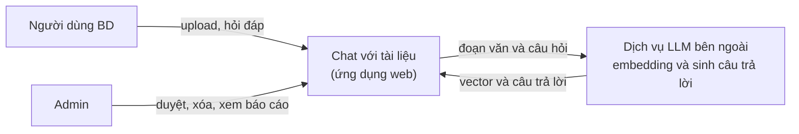
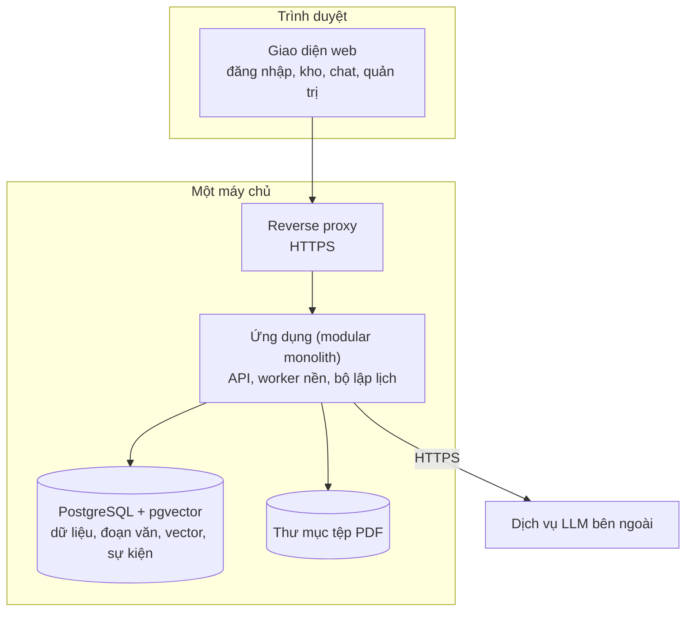
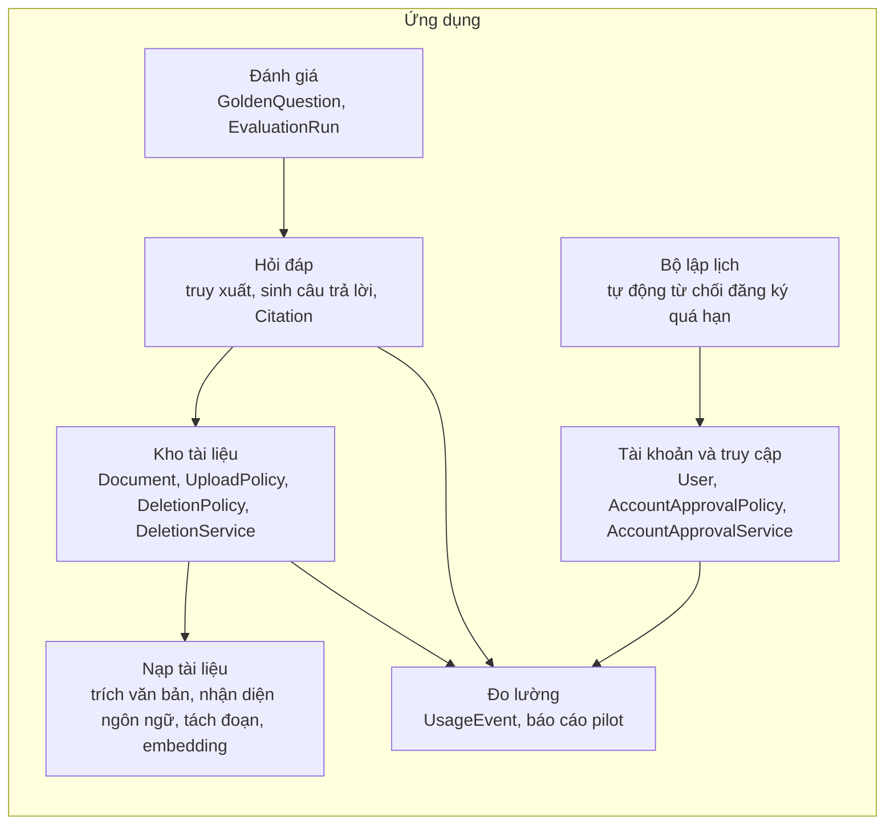
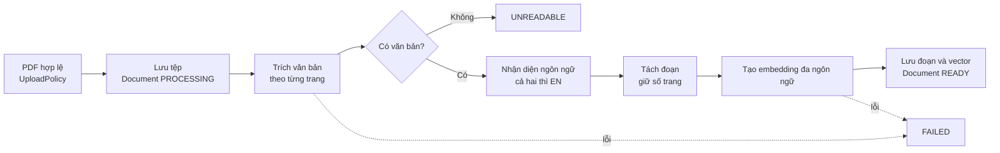
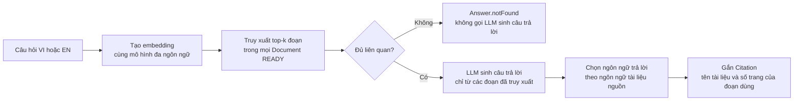
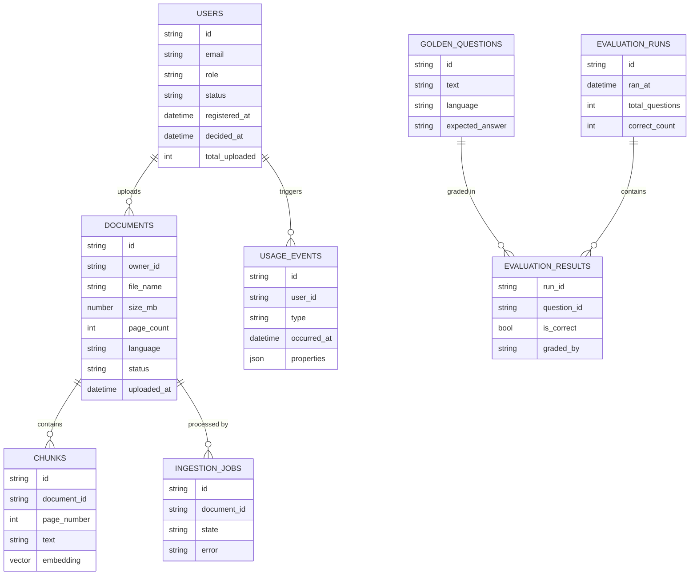
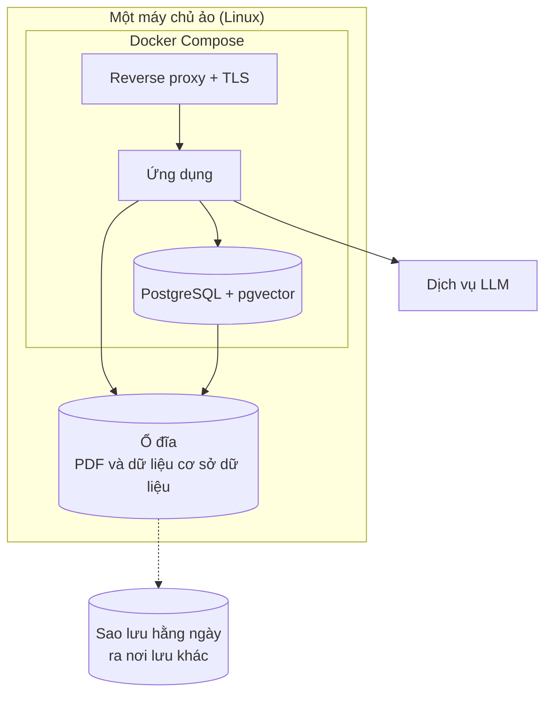

# Software Architecture Document (SAD) — Chat với tài liệu (MVP)

> Chuẩn tham chiếu: ISO/IEC/IEEE 42010 (mô tả kiến trúc theo stakeholder, concern và view). Các view dùng cách vẽ C4 bằng Mermaid.
> Mọi lựa chọn công nghệ trong tài liệu này là **đề xuất (Proposed)**, chưa được người yêu cầu xác nhận. Mục 9 liệt kê những quyết định cần bạn chốt.

## 0. Kiểm soát tài liệu

| Mục | Giá trị |
|---|---|
| Tiêu đề | SAD — Chat với tài liệu (MVP) |
| Số tài liệu | SAD-CDT-001 |
| Phiên bản | 0.2 (thêm hồ sơ demo local, mục 14) |
| Trạng thái | Draft |
| Ngày | 2026-11-02 |
| Tác giả | Business Analyst |
| Đầu vào | `BRD.md` v0.11, `PRD.md` v0.5, `class-diagram.md` v0.6, `sequence-diagrams.md` v0.1, `use-cases.md` v0.1 |

## 1. Tóm tắt kiến trúc

**Một khối ứng dụng web duy nhất (modular monolith)** chạy trên một máy chủ, dùng **PostgreSQL có pgvector** vừa làm cơ sở dữ liệu vừa làm kho vector, và gọi **một dịch vụ LLM bên ngoài** để tạo embedding và câu trả lời. Tài liệu PDF xử lý nền trong cùng ứng dụng (hàng đợi lưu trong cơ sở dữ liệu).

Lý do: 30 người dùng, hạn 14 ngày, chi phí phải tối thiểu (CON-005). Mọi thành phần phân tán thêm (message broker, microservice, cụm Kubernetes, vector database riêng) đều tốn thêm công vận hành mà không có nhu cầu tải tương ứng.

**Yếu tố quyết định kiến trúc nằm ở pipeline hỏi đáp** (mục 5), không phải ở web hay cơ sở dữ liệu. Độ chính xác từ 90% (BR-010), trích đúng số trang (BR-008) và hỏi chéo ngôn ngữ (BR-015) phụ thuộc vào cách tách đoạn, chọn mô hình embedding và cách ràng buộc câu trả lời vào nguồn.

## 2. Stakeholder và mối quan tâm (concern)

| Stakeholder | Mối quan tâm đối với kiến trúc | Giải quyết ở |
|---|---|---|
| Người dùng BD (STK-001) | Câu trả lời nhanh, đúng, có nguồn | Mục 5, 7 |
| Admin (STK-006) | Duyệt tài khoản, xóa tài liệu, xem báo cáo | Mục 4.3, 6 |
| Sponsor (STK-002) | Chi phí thấp, có số liệu pilot, kịp hạn | Mục 8, 10 |
| IT, bảo mật (STK-003) | Không công khai tài liệu, dữ liệu gửi ra ngoài | Mục 7.3 |
| Đội phát triển | Đơn giản, làm kịp 14 ngày | Mục 1, 9 |

## 3. Động lực kiến trúc

### 3.1 Thuộc tính chất lượng

| ID | Thuộc tính | Kịch bản | Ngưỡng | Nguồn |
|---|---|---|---|---|
| QA-1 | Hiệu năng | Người dùng gửi câu hỏi | Tối đa 30 giây cho 90% câu hỏi | BR-009, NFR-001 |
| QA-2 | Chính xác | Chạy bộ câu hỏi chuẩn | Từ 90%; mỗi thông tin trích có tên tài liệu và số trang đúng | BR-008, BR-010, NFR-002 |
| QA-3 | Tin cậy của nội dung | Hỏi câu không có đáp án | 100% trả lời "không tìm thấy", không bịa | BR-007 |
| QA-4 | Bảo mật truy cập | Chưa đăng nhập hoặc chưa duyệt | Không xem được kho; chỉ người upload và admin xóa được | BR-012, BR-013, BR-017, BR-020 |
| QA-5 | Dung lượng | Upload | 100 MB mỗi tệp, 100 tệp mỗi người | BR-002, BR-016 |
| QA-6 | Chi phí | Toàn bộ pilot | Tối thiểu hóa, chưa có mức trần | CON-005 |
| QA-7 | Khả dụng | (không có yêu cầu) | `[TBD]` Giả định: dùng trong giờ làm việc, không có SLA. Cần xác nhận | Khoảng trống của BRD |

### 3.2 Ràng buộc

| ID | Ràng buộc | Tác động lên kiến trúc |
|---|---|---|
| CON-002 | Ứng dụng web | Giao diện trình duyệt; không có app di động |
| CON-003 | Chỉ PDF | Chỉ cần một bộ trích văn bản PDF |
| CON-004 | Hỏi đáp dùng AI | Cần mô hình ngôn ngữ; câu trả lời có tính xác suất nên phải ràng buộc vào nguồn |
| CON-005 | Chi phí tối thiểu; pilot bắt đầu 2026-11-03 | Ít thành phần, dịch vụ trả theo mức dùng |
| CON-006 | Không cấm dùng dịch vụ AI; tài liệu không mật nhưng không công khai rộng | Cho phép gọi LLM bên ngoài; vẫn bắt buộc đăng nhập |
| BRU-003 | Xóa vĩnh viễn | Xóa phải lan tới tệp, đoạn văn và vector (mục 7.4) |

### 3.3 Ước lượng tải

Từ SRC-002 (chưa xác thực, ASM-004): 30 người, 5 đến 10 lần tìm thông tin mỗi người mỗi ngày. Nếu mỗi lần là một câu hỏi thì khoảng 150 đến 300 câu hỏi mỗi ngày, tương đương 9.000 đến 18.000 câu hỏi trong 60 ngày pilot.

- Số người dùng đồng thời rất thấp, một vài người cùng lúc. Không cần mở rộng ngang.
- **Dung lượng lưu trữ trường hợp xấu nhất:** 30 người × 100 tệp × 100 MB = 300 GB. Thực tế thấp hơn nhiều, nhưng số tài liệu hiện có chưa biết (OQ-017). Cần chọn dung lượng ổ đĩa có thể mở rộng.

## 4. View ngữ cảnh và container

### 4.1 Ngữ cảnh hệ thống

Không có tích hợp CRM, DMS hay đăng nhập một lần (SSO). Các mục đó nằm ngoài phạm vi (BRD mục 5).

### 4.2 Container

### 4.3 Module trong ứng dụng

Tên lớp lấy từ `class-diagram.md`. Mỗi module sở hữu dữ liệu của mình, các module gọi nhau qua giao diện trong cùng tiến trình. Nếu sau này cần tách thành dịch vụ riêng, ranh giới module đã sẵn.

## 5. Pipeline hỏi đáp (quyết định chính)

### 5.1 Nạp tài liệu (UC-05)

- **Giữ số trang đến cuối pipeline.** Mỗi đoạn văn lưu `document_id` và `page_number`, vì Citation (BR-008) cần số trang. Tách đoạn không được cắt ngang trang mà làm mất số trang.
- **PDF bản scan:** MVP không có OCR, nên tài liệu không có văn bản thành `UNREADABLE` (ASM-001).
- **Xử lý nền:** upload trả về ngay với trạng thái `PROCESSING`. Worker nền nhận việc từ bảng công việc trong cơ sở dữ liệu.

### 5.2 Trả lời câu hỏi (UC-08)

Ba thiết kế để đạt các yêu cầu khó:

1. **Embedding đa ngôn ngữ (BR-015).** Câu hỏi tiếng Anh về tài liệu tiếng Việt chỉ truy xuất được nếu câu hỏi và đoạn văn nằm chung một không gian vector đa ngôn ngữ. Một mô hình embedding chỉ hỗ trợ tiếng Anh sẽ làm hỏng các ca TC-042 và TC-043.
2. **Ràng buộc câu trả lời vào nguồn (BR-007, BRU-002).** LLM chỉ nhận các đoạn đã truy xuất và được yêu cầu từ chối khi chúng không đủ. Khi độ liên quan thấp hơn ngưỡng, trả "không tìm thấy" mà không gọi LLM. Ngưỡng cần hiệu chỉnh bằng bộ câu hỏi chuẩn `[TBD]`.
3. **Citation sinh từ đoạn đã dùng, không do LLM tự nêu.** Hệ thống lấy `document_id` và `page_number` của đoạn được truy xuất, nên số trang không bị bịa. Đây là cách giảm rủi ro trích sai trang (RSK-001).

Ngôn ngữ câu trả lời (BR-021, BRU-009): lấy theo ngôn ngữ của tài liệu nguồn. Nguồn có cả VI và EN thì trả lời tiếng Anh. Quy tắc này được đưa vào chỉ dẫn gửi LLM.

### 5.3 Ngân sách thời gian (QA-1, 30 giây)

| Bước | Ghi chú |
|---|---|
| Embedding câu hỏi | Một lần gọi, thường rất ngắn |
| Truy xuất vector | Trên vài chục nghìn đoạn thì rất nhanh với chỉ mục phù hợp |
| LLM sinh câu trả lời | Bước chậm nhất. Đa số thời gian nằm ở đây |

Không có số đo thực tế. Phải đo trên bộ câu hỏi chuẩn (TC-048) trước phát hành `[TBD]`.

## 6. Dữ liệu

- **Không có bảng câu hỏi hoặc câu trả lời.** Quyết định không lưu lịch sử (OQ-013) và không ghi nội dung (OQ-024). Question, Answer và Citation chỉ tồn tại trong bộ nhớ của phiên.
- **`usage_events.user_id` có thể rỗng** cho `LOGIN_FAILED` với email không tồn tại.
- **`total_uploaded` chỉ tăng**, không giảm khi xóa (BRU-007).
- Mật khẩu (hoặc thông tin xác thực) nằm trong bảng người dùng dưới dạng băm, không lưu văn bản gốc (mục 7.1).

## 7. Bảo mật

### 7.1 Xác thực và phân quyền

- Đăng nhập bằng email và mật khẩu, mật khẩu lưu dạng băm có muối bằng thuật toán chuyên dụng (ví dụ argon2 hoặc bcrypt). Phiên bằng cookie `HttpOnly`, `Secure`, `SameSite`.
- Mọi kiểm tra quyền thực hiện **ở phía máy chủ**: `status = APPROVED` (BR-012, BR-020), `DeletionPolicy.canDelete` (BR-013, BR-017), vai trò `ADMIN` cho quản trị. Giao diện chỉ ẩn nút, không phải lớp bảo vệ.
- Tài khoản admin có sẵn (BR-019) tạo bằng cấu hình hoặc bước khởi tạo, mật khẩu ban đầu bắt buộc đổi, không ghi trong mã nguồn.
- Giới hạn số lần đăng nhập sai và số lần đăng ký theo thời gian, để chống dò mật khẩu và đăng ký tràn.

### 7.2 Kiểm tra tệp upload

- Kiểm tra nội dung tệp là PDF (không chỉ phần mở rộng), kích thước tối đa 100 MB, `totalUploaded` dưới 100 (`UploadPolicy`).
- Tệp lưu bằng tên do hệ thống sinh, không dùng tên người dùng đặt làm đường dẫn.

### 7.3 Dữ liệu gửi ra dịch vụ LLM

- Các đoạn văn và câu hỏi được gửi tới dịch vụ bên ngoài. SRC-002 cho biết không cấm, SRC-003 cho biết tài liệu không mật, nhưng ASM-003 (tài liệu thật không có thông tin mật) **chưa được rà soát**. Phải rà soát PDF mẫu trước khi nạp tài liệu thật (cổng G9).
- Nên chọn chế độ không lưu dữ liệu (zero retention) hoặc không dùng dữ liệu để huấn luyện nếu nhà cung cấp có `[TBD: OQ-033]`.
- **Tài liệu là dữ liệu không tin cậy.** Một PDF có thể chứa văn bản kiểu "bỏ qua mọi chỉ dẫn trước đó". Giảm thiểu: đặt chỉ dẫn hệ thống tách biệt khỏi đoạn trích, LLM không được cấp công cụ hay quyền gì ngoài sinh văn bản, và Citation do hệ thống gắn (mục 5.2).

### 7.4 Xóa vĩnh viễn (BRU-003)

Khi xóa một Document (UC-07), phải xóa trong cùng một giao dịch hoặc theo thứ tự có kiểm tra: tệp PDF, mọi `chunks` (gồm vector) và `ingestion_jobs` của tài liệu. `usage_events` không chứa nội dung nên không cần xóa.

**Vấn đề với bản sao lưu:** BR-013 yêu cầu xóa vĩnh viễn, nhưng bản sao lưu cơ sở dữ liệu và thư mục tệp vẫn còn dữ liệu cũ cho tới khi hết thời gian giữ. Cần quyết định thời gian giữ bản sao lưu và chấp nhận hay không `[TBD: OQ-034]`.

## 8. Triển khai

- Một máy chủ, ba container (proxy, ứng dụng, cơ sở dữ liệu), chạy bằng Docker Compose. Đơn giản nhất và rẻ nhất, đủ cho 30 người.
- **Đánh đổi:** không có dự phòng. Máy chủ hỏng thì dịch vụ dừng cho tới khi khôi phục từ bản sao lưu. Chấp nhận được cho MVP (QA-7 chưa có yêu cầu), nhưng cần thử khôi phục ít nhất một lần.
- Cấu hình, khóa API và mật khẩu qua biến môi trường hoặc tệp bí mật, không đưa vào kho mã nguồn.

## 9. Quyết định kiến trúc (ADR)

Tất cả ở trạng thái **Proposed**. Từ v0.2, mục 14 (hồ sơ demo local) ghi đè D-02, D-03, D-04, D-06, D-07 và D-09 cho giai đoạn demo.

| ID | Quyết định | Phương án đã cân nhắc | Lý do chọn | Cần bạn xác nhận |
|---|---|---|---|---|
| D-01 | Modular monolith, một đơn vị triển khai | Microservice; serverless | 30 người dùng, 14 ngày, chi phí thấp. Microservice thêm công vận hành mà không có nhu cầu tải | Không |
| D-02 | Backend: **Java 21 với Spring Boot** nếu đội dùng Java; nếu không, **Python với FastAPI** | Node.js (TypeScript) | Spring Boot có sẵn xác thực, phân quyền, lập lịch, JPA. Python có hệ sinh thái PDF và AI mạnh hơn. Chọn theo kỹ năng đội, vì tốc độ viết quyết định kịp hạn. Gợi ý Java vì thấy bạn đang học Spring Boot, chưa xác nhận | **Có (OQ-032)** |
| D-03 | PostgreSQL + pgvector cho cả dữ liệu và vector | Vector database riêng; SQLite | Một thành phần thay vì hai. Quy mô vài chục nghìn đoạn là nhỏ với pgvector. Xóa Document xóa vector trong cùng cơ sở dữ liệu | Không |
| D-04 | Lưu PDF trên ổ đĩa của máy chủ, truy cập qua một lớp trừu tượng | Object storage (S3 hoặc tương đương) | Rẻ nhất, ít thành phần. Lớp trừu tượng cho phép đổi sang object storage khi cần | Không |
| D-05 | RAG: tách đoạn giữ số trang, embedding đa ngôn ngữ, truy xuất top-k, ngưỡng "không tìm thấy" | Đưa toàn bộ tài liệu vào ngữ cảnh LLM; tìm kiếm từ khóa | Toàn bộ tài liệu không vừa ngữ cảnh khi kho lớn. Từ khóa không hỏi chéo ngôn ngữ được. Cần số trang chính xác | Không |
| D-06 | Gọi dịch vụ LLM bên ngoài (trả theo mức dùng). Chọn mô hình bằng cách đo trên bộ câu hỏi chuẩn | Tự chạy mô hình mã nguồn mở | Tự chạy cần GPU, chi phí cố định cao và công vận hành. Với 150 đến 300 câu hỏi mỗi ngày, trả theo mức dùng thường rẻ hơn. Phải có cả embedding và sinh câu trả lời hỗ trợ tiếng Việt | **Có (OQ-033)**: nhà cung cấp, mức trần ngân sách |
| D-07 | Hàng đợi nền lưu trong PostgreSQL, worker chạy trong ứng dụng | Redis hoặc RabbitMQ | Không thêm thành phần. Đủ cho một vài upload cùng lúc | Không |
| D-08 | Xác thực bằng phiên cookie và mật khẩu băm; phân quyền theo vai trò | SSO; JWT không trạng thái | SSO ngoài phạm vi. Phiên phía máy chủ cho phép thu hồi tức thời khi tài khoản bị từ chối | Không |
| D-09 | Một máy ảo + Docker Compose + sao lưu hằng ngày | PaaS (container và cơ sở dữ liệu quản lý sẵn) | Rẻ nhất. PaaS ít việc vận hành hơn nhưng đắt hơn và cần đánh giá nhà cung cấp | **Có (OQ-035)**: nhà cung cấp cloud và tài khoản có sẵn |
| D-10 | Quan sát: nhật ký có cấu trúc, đo độ trễ, sự kiện sử dụng lưu trong PostgreSQL; không ghi nội dung câu hỏi | Công cụ giám sát bên thứ ba | Đủ cho MET-002 và báo cáo pilot, không thêm dịch vụ | Không |

## 10. Rủi ro kiến trúc

| ID | Rủi ro | Ảnh hưởng | Giảm thiểu |
|---|---|---|---|
| AR-1 | Độ chính xác dưới 90% vì tách đoạn hoặc truy xuất kém | Không đạt G2 (cổng bắt buộc) | Có bộ câu hỏi chuẩn sớm; thử nhiều cỡ đoạn và mô hình embedding; chấm lại sau mỗi thay đổi (UC-11) |
| AR-2 | Thời gian nạp tài liệu 100 MB quá lâu | Người dùng chờ nhiều phút, `PROCESSING` kéo dài | Xử lý nền, hiển thị trạng thái; đo thời gian thực tế; giới hạn số tệp xử lý song song |
| AR-3 | Chi phí LLM vượt dự kiến | Vi phạm CON-005 | Đặt hạn mức gọi mỗi người mỗi ngày nếu cần; theo dõi số token theo ngày; chọn mô hình nhỏ nếu đạt G2 |
| AR-4 | Máy chủ đơn bị hỏng | Dừng dịch vụ | Sao lưu hằng ngày và thử khôi phục; chấp nhận cho MVP |
| AR-5 | Dữ liệu thật có thông tin mật gửi ra ngoài | Lộ dữ liệu (RSK-002) | Rà soát mẫu (G9); chế độ không lưu dữ liệu; chặn nạp nếu phát hiện |
| AR-6 | Tiếng Việt kém trong embedding hoặc LLM | Sai ở các ca VI | Chọn mô hình đã được thử trên bộ câu hỏi tiếng Việt, không chỉ tiếng Anh |
| AR-7 | Tấn công prompt injection qua nội dung PDF | Câu trả lời bị thao túng | Mục 7.3 |

## 11. Truy vết yêu cầu tới kiến trúc

| Yêu cầu | Phần tử kiến trúc |
|---|---|
| BR-001, BR-002, BR-003, BR-016 | Module Kho tài liệu, `UploadPolicy`, mục 7.2 |
| BR-004, BR-013, BR-017 | Module Kho tài liệu, thư mục PDF, PostgreSQL, mục 7.4 |
| BR-005, BR-006, BR-007 | Pipeline hỏi đáp, ngưỡng "không tìm thấy" (mục 5.2) |
| BR-008 | Số trang giữ trong `chunks`, Citation sinh từ đoạn đã dùng (mục 5) |
| BR-009 | Ngân sách thời gian (5.3), xử lý nền cho upload, truy xuất vector |
| BR-010 | Module Đánh giá, bộ câu hỏi chuẩn (UC-11) |
| BR-011, BR-015, BR-021 | Embedding đa ngôn ngữ, chọn ngôn ngữ trả lời theo tài liệu nguồn (mục 5) |
| BR-012, BR-018, BR-019, BR-020, BR-022 | Module Tài khoản, mục 7.1, bộ lập lịch |
| BR-014 | Module Đo lường, bảng `usage_events` |
| BRU-007 | `users.total_uploaded` chỉ tăng |
| BRU-008 | Nhận diện ngôn ngữ trong pipeline nạp (mục 5.1) |
| CON-005 | D-01, D-03, D-04, D-07, D-09 |

## 12. Câu hỏi mở của kiến trúc

| ID | Câu hỏi | Ảnh hưởng |
|---|---|---|
| OQ-032 | Đội có ngôn ngữ lập trình và nền tảng nào đã quen? | **Đã đóng 2026-11-02**: Python với FastAPI |
| OQ-033 | Dùng dịch vụ LLM nào, mức trần chi phí là bao nhiêu, nhà cung cấp có chế độ không lưu dữ liệu không? | **Đã đóng 2026-11-02**: dùng loại miễn phí, không cần chất lượng cao, BA tự chọn. Chọn mô hình chạy local bằng Ollama (mục 14) |
| OQ-034 | Bản sao lưu giữ bao lâu, và có chấp nhận dữ liệu đã xóa còn trong bản sao lưu tới khi hết hạn giữ không? | Chưa áp dụng cho demo local (không có sao lưu). Mở lại khi lên pilot |
| OQ-035 | Dùng nhà cung cấp cloud nào, đã có tài khoản và máy chủ chưa? | **Đã đóng 2026-11-02**: test local trước, chưa cần cloud |
| OQ-036 | Có yêu cầu về khả dụng (giờ hoạt động, thời gian dừng chấp nhận được) không? | Chưa áp dụng cho demo local. Mở lại khi lên pilot |

OQ-017 (số tài liệu hiện có) ảnh hưởng dung lượng ổ đĩa.

## 13. Bước tiếp theo

1. Xác nhận D-02, D-06, D-09 (OQ-032, OQ-033, OQ-035). Ba quyết định này chặn việc bắt đầu viết mã.
2. Chuẩn bị bộ câu hỏi chuẩn và PDF mẫu sớm (DEP-002). Bộ này vừa để chọn mô hình (D-06) vừa để nghiệm thu G2.
3. Thử nhanh pipeline (nạp 5 đến 10 PDF thật, hỏi 20 câu) trước khi dựng đủ ứng dụng, vì độ chính xác là rủi ro lớn nhất (AR-1).
4. Chuyển các câu hỏi OQ-032..OQ-036 vào bảng câu hỏi mở của BRD nếu bạn muốn quản lý tập trung.
5. Render Mermaid để kiểm tra cú pháp (chưa kiểm tra bằng công cụ).

## 14. Hồ sơ demo local (quyết định 2026-11-02)

Theo chỉ đạo của người yêu cầu: backend **Python với FastAPI**; mô hình **miễn phí, không cần chất lượng cao**; **chạy local, chưa cần cloud**; mục tiêu **hoàn thành demo nhanh và nhẹ nhàng nhất**. Các quyết định còn lại do BA chọn theo hướng đó. Hồ sơ này ghi đè các ADR tương ứng ở mục 9 cho giai đoạn demo. Hồ sơ pilot (mục 9) vẫn là hướng nâng cấp.

Môi trường đã kiểm tra: Python 3.12.4, GPU RTX 4060 8 GB, RAM 15 GB, chưa cài Ollama.

| ID | Quyết định cho demo | Thay cho | Lý do |
|---|---|---|---|
| D-02 | Python 3.12, FastAPI, Jinja2 và một ít JavaScript thuần cho giao diện. Không dùng SPA | D-02 | Người yêu cầu chọn. Giao diện sinh phía máy chủ là nhẹ nhất |
| D-03 | **SQLite**, vector lưu dạng BLOB, tính cosine bằng numpy | PostgreSQL và pgvector | Không cần cài đặt hay Docker. Với vài nghìn đoạn văn tìm kiếm tuần tự vẫn nhanh. Nâng lên pgvector khi lên pilot |
| D-04 | PDF lưu trong thư mục `app_data/uploads` | D-04 | Đơn giản nhất |
| D-06 | **Ollama chạy local**: embedding `bge-m3` (đa ngôn ngữ) và chat `qwen2.5:3b` | Dịch vụ LLM bên ngoài | Miễn phí, không cần tài khoản hay khóa API. Tài liệu không rời khỏi máy (giải quyết lo ngại ở mục 7.3). `bge-m3` hỗ trợ truy xuất chéo ngôn ngữ Việt và Anh (BR-015). `qwen2.5:3b` nhẹ, đổi sang `qwen2.5:7b` bằng biến môi trường nếu muốn chất lượng cao hơn (vừa với 8 GB VRAM) |
| D-06b | Có **chế độ stub** (`LLM_PROVIDER=stub`): embedding băm từ khóa, câu trả lời lấy đoạn trích | — | Chạy và kiểm thử được khi chưa cài Ollama. Chất lượng thấp, không hỏi chéo ngôn ngữ được. Dùng cho test tự động |
| D-07 | Xử lý nền bằng `BackgroundTasks` của FastAPI | Hàng đợi trong cơ sở dữ liệu | Không thêm thành phần nào |
| D-08 | Phiên cookie của Starlette; mật khẩu băm bằng `scrypt` có sẵn trong thư viện chuẩn | D-08 | Không thêm thư viện |
| D-09 | Chạy bằng `uvicorn` trên máy, không Docker | Máy ảo và Docker Compose | Local, chưa cần cloud |
| — | Tự động từ chối đăng ký quá hạn bằng tác vụ `asyncio` chạy mỗi giờ | Bộ lập lịch riêng | Không cần thư viện lập lịch |
| — | Trích văn bản bằng `pypdf`; nhận diện ngôn ngữ bằng đếm ký tự tiếng Việt và từ phổ biến tiếng Anh (cả hai thì EN, BRU-008) | — | Không cần thư viện nhận diện ngôn ngữ |

**Những gì demo cố ý không làm** (để nhẹ và nhanh): OCR cho PDF scan (thành `UNREADABLE`), sao lưu, giám sát, Docker, gửi email thông báo, giao diện quản trị phức tạp. Báo cáo pilot (UC-10) chỉ là một trang số liệu đơn giản; bộ câu hỏi chuẩn (UC-11) chạy bằng tập lệnh riêng.

**Hạn chế đã biết của demo:** chất lượng trả lời thấp hơn pilot (mô hình nhỏ). Không đo được G2 (độ chính xác từ 90%) và G4 (30 giây) một cách có ý nghĩa cho tới khi chạy trên mô hình thật và bộ câu hỏi chuẩn. Mật khẩu admin mặc định chỉ dành cho demo local.
