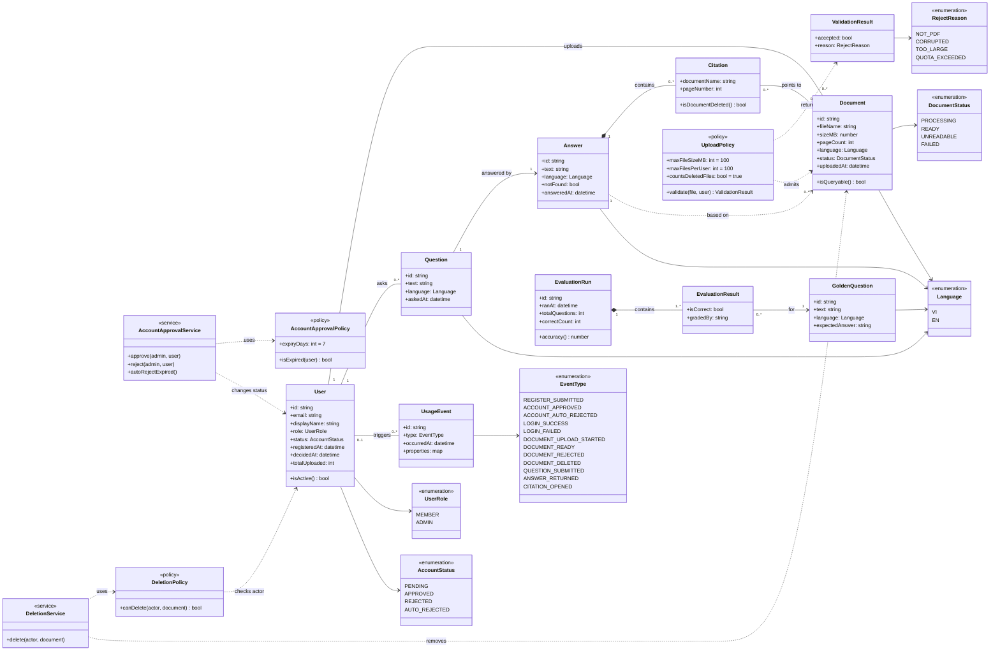

# Class diagram — Chat với tài liệu (MVP)

> Mức: mô hình miền (domain model), độc lập công nghệ. Chưa chọn ngôn ngữ, framework, cơ sở dữ liệu hay dịch vụ AI. Các lựa chọn đó thuộc tài liệu kiến trúc (SAD).

## 0. Kiểm soát tài liệu

| Mục | Giá trị |
|---|---|
| Tiêu đề | Class diagram — Chat với tài liệu (MVP) |
| Số tài liệu | CLS-CDT-001 |
| Phiên bản | 0.6 |
| Trạng thái | Draft |
| Tác giả | Business Analyst |
| Đầu vào | `docs/requirements/BRD.md` v0.11, `docs/requirements/PRD.md` v0.5 |

| Phiên bản | Ngày | Tác giả | Tóm tắt thay đổi |
|---|---|---|---|
| 0.1 | 2026-11-02 | Business Analyst | Bản nháp đầu tiên |
| 0.2 | 2026-11-02 | Business Analyst | Sửa theo review: thêm lớp đo MET-003 (GoldenQuestion, EvaluationRun, EvaluationResult); sửa multiplicity Answer-Document và User-UsageEvent; thêm trạng thái FAILED; đổi approve/delete sang service; bỏ `Answer.latencyMs`; thêm OQ-027..OQ-029 |
| 0.3 | 2026-11-02 | Business Analyst | Đóng OQ-027: Citation giữ tên tài liệu và hiển thị nhãn "đã xóa"; `Citation` thêm `documentName`, trỏ tới Document `0..1`; thêm OQ-030 |
| 0.4 | 2026-11-02 | Business Analyst | Hạn mức tệp tính tổng số đã upload (`User.totalUploaded`, BRU-007); tài liệu có cả hai ngôn ngữ coi là tiếng Anh (BRU-008); đóng OQ-028, OQ-029; thêm OQ-031 |
| 0.5 | 2026-11-02 | Business Analyst | Không lưu lịch sử chat (OQ-013): Question, Answer, Citation chỉ tồn tại trong phiên, không thêm `Conversation`; đóng OQ-030; OQ-027 chỉ áp dụng trong phiên; đóng OQ-031 (không cần cấm upload lại) |
| 0.6 | 2026-11-02 | Business Analyst | Bỏ `ANSWER_FEEDBACK` (EVT-009 loại khỏi MVP); nguồn trộn ngôn ngữ thì `Answer.language` là EN (BRU-009); đăng ký lại đưa `User.status` về PENDING (BRU-010); đóng OQ-025, OQ-026 |

## 1. Class diagram

Quan hệ `User -- Document` và `User -- Question` không có mũi tên, nghĩa là điều hướng được cả hai chiều. `DeletionPolicy` cần đọc chủ sở hữu từ Document, và Question cần biết người hỏi.

`Question`, `Answer` và `Citation` chỉ tồn tại trong phiên, không lưu (quyết định 2026-11-02, OQ-013). Vì vậy không có lớp `Conversation`.

## 2. Truy vết lớp tới yêu cầu

| Lớp | Vai trò | BR | US |
|---|---|---|---|
| User, UserRole, AccountStatus | Tài khoản, vai trò Member/Admin, trạng thái duyệt | BR-012, BR-018, BR-019, BR-020, BR-022 | US-001..US-004, US-016 |
| AccountApprovalPolicy, AccountApprovalService | Admin duyệt, quá 7 ngày tự động từ chối | BR-020, BR-022, BRU-005, BRU-006 | US-003, US-016 |
| Document, DocumentStatus, Language | Tài liệu PDF trong kho chung, trạng thái xử lý, ngôn ngữ tài liệu | BR-001, BR-004, BR-011 | US-005, US-007 |
| UploadPolicy, ValidationResult, RejectReason | Giới hạn 100 MB mỗi tệp và 100 tệp mỗi người; lý do từ chối | BR-002, BR-003, BR-016 | US-005, US-006 |
| DeletionPolicy, DeletionService | Người upload xóa tài liệu của mình; admin xóa mọi tài liệu | BR-013, BR-017, BRU-004 | US-008, US-009 |
| Question | Câu hỏi bằng tiếng Việt hoặc tiếng Anh | BR-005, BR-006, BR-015 | US-010, US-013 |
| Answer | Câu trả lời, cờ "không tìm thấy" | BR-005, BR-007, BR-021 | US-010, US-012, US-013 |
| Citation | Tài liệu nguồn và số trang; nếu tài liệu đã xóa thì giữ tên và hiển thị nhãn "đã xóa" | BR-008, BR-013 | US-011, US-008 |
| UsageEvent, EventType | Dữ liệu sử dụng: MET-002 và thời gian trả lời (BR-009) | BR-009, BR-014 | US-015 |
| GoldenQuestion, EvaluationRun, EvaluationResult | Bộ câu hỏi chuẩn và lần chấm điểm: MET-003, cổng G2 | BR-010, BR-014 | NFR-002, US-015 |

**Ngoài mô hình:** MET-001 (thời gian tìm thông tin) đo bằng nghiên cứu tác vụ mẫu trước và sau, không từ dữ liệu của ứng dụng (PRD mục 5.2). Kho tài liệu chung không có lớp riêng, vì nó là tập hợp mọi Document đang tồn tại (BRU-001).

## 3. Quyết định mô hình hóa

1. **Quy tắc và hành động tách riêng.** Policy giữ giá trị và phép kiểm tra (7 ngày, 100 MB, 100 tệp, ai được xóa). Service thực thi thay đổi (duyệt, từ chối, xóa). Lý do: con số và quy tắc kinh doanh có thể đổi mà không đổi hành động.
2. **Xóa là xóa vĩnh viễn** (BRU-003). `DocumentStatus` không có trạng thái `DELETED`.
3. **Ngôn ngữ câu trả lời lấy từ tài liệu nguồn** (BR-021). `Answer.language` là ngôn ngữ của tài liệu, không phải `Question.language`.
4. **Tệp bị từ chối không thành Document.** Nó chỉ sinh `ValidationResult` và sự kiện `DOCUMENT_REJECTED` (US-006).
5. **Hai trạng thái lỗi xử lý tách biệt.** `UNREADABLE` là PDF không có văn bản đọc được (bản scan, ASM-001). `FAILED` là lỗi xử lý khác (hết thời gian, lỗi hệ thống). Cả hai nằm trong kho nhưng không dùng để truy vấn (`isQueryable()`).
6. **Câu trả lời "không tìm thấy" không dựa trên tài liệu nào** (US-012), nên quan hệ `Answer ..> Document` có multiplicity `0..*`.
7. **`UsageEvent` có thể không có User** (`0..1`), vì `LOGIN_FAILED` với email không tồn tại không gắn được vào tài khoản.
8. **`UsageEvent.properties` không chứa nội dung câu hỏi hoặc câu trả lời**, vì chưa có quyết định về quyền riêng tư (OQ-024). Thời gian trả lời nằm trong sự kiện `ANSWER_RETURNED`, không lặp trong `Answer`.
9. **Không có `ANSWER_FEEDBACK`.** EVT-009 bị loại khỏi MVP (quyết định ủy quyền 2026-11-02, OQ-024).
10. **Thông tin xác thực** (mật khẩu hoặc cơ chế khác) chưa có trong `User`. Đây là chi tiết thiết kế, thuộc SAD (BR-012 chỉ yêu cầu đăng nhập, không quy định cách).
11. **Citation sống sót sau khi tài liệu bị xóa** (OQ-027, quyết định 2026-11-02). Citation giữ `documentName` và `pageNumber`; liên kết tới Document thành `0..1` và rỗng khi tài liệu đã xóa. Giao diện hiển thị tên tài liệu kèm nhãn "đã xóa", không mở được nguồn. Vì không lưu lịch sử (OQ-013), quyết định này chỉ áp dụng cho câu trả lời đang hiển thị trong phiên khi tài liệu bị xóa giữa chừng.
12. **Hạn mức tệp tính tổng số đã upload** (OQ-028, BRU-007). `User.totalUploaded` chỉ tăng, không giảm khi xóa Document. `UploadPolicy.validate` so sánh `totalUploaded` với `maxFilesPerUser`. Đã xác nhận (OQ-031): không cần cấm upload lại đúng tệp đã xóa, nên không cần ghi nhận định danh tệp đã xóa.
13. **Tài liệu có cả hai ngôn ngữ coi là tiếng Anh** (OQ-029, BRU-008). `Language` giữ hai giá trị `VI` và `EN`, không cần `MIXED`. Cách nhận diện ngôn ngữ thuộc SAD.
14. **Nguồn trộn ngôn ngữ thì trả lời bằng tiếng Anh** (OQ-025, BRU-009). Nếu các Document mà `Answer` dựa vào có cả `VI` và `EN`, thì `Answer.language = EN`.
15. **Đăng ký lại** (OQ-026, BRU-010). Người có `status` là `REJECTED` hoặc `AUTO_REJECTED` đăng ký lại bằng cùng email thì dùng lại `User`, `status` về `PENDING` và `registeredAt` đổi sang thời điểm mới. Không có giới hạn một Admin trong mô hình; BR-019 chỉ yêu cầu có sẵn một tài khoản.

## 4. Điểm chưa chốt (ảnh hưởng mô hình)

| ID | Vấn đề | Ảnh hưởng tới lớp |
|---|---|---|
| OQ-013 | Có lưu lịch sử hội thoại không? | **Đã đóng 2026-11-02**: không lưu. Question, Answer, Citation chỉ tồn tại trong phiên; không thêm `Conversation` |
| OQ-025 | Câu trả lời dựa trên tài liệu tiếng Việt và tiếng Anh cùng lúc dùng ngôn ngữ nào? | **Đã đóng 2026-11-02**: tiếng Anh (quyết định 14) |
| OQ-026 | Người bị tự động từ chối có đăng ký lại được không? Có admin dự phòng không? | **Đã đóng 2026-11-02**: đăng ký lại được, `status` về `PENDING` (quyết định 15). Không có admin dự phòng trong MVP |
| OQ-027 | Nếu lưu lịch sử, `Citation` của câu trả lời cũ trỏ tới Document đã bị xóa thì xử lý thế nào? | **Đã đóng 2026-11-02**: báo là đã xóa. Citation giữ tên tài liệu và nhãn "đã xóa" (quyết định 11) |
| OQ-028 | Hạn mức 100 tệp mỗi người tính tệp đang có hay tổng số đã upload? Xóa rồi có upload lại được không? | **Đã đóng 2026-11-02**: tính tổng số đã upload, xóa không hoàn lại (quyết định 12). Cách hiểu cần xác nhận: OQ-031 |
| OQ-029 | Ngôn ngữ của Document được xác định thế nào, và PDF có cả tiếng Việt lẫn tiếng Anh thì gán ngôn ngữ nào? | **Đã đóng một phần 2026-11-02**: coi là tiếng Anh (quyết định 13). Cách nhận diện ngôn ngữ thuộc SAD |
| OQ-030 | Nếu lưu lịch sử chat, `Answer.text` cũ có thể còn nội dung lấy từ tài liệu đã xóa. Có phải xóa hoặc che nội dung đó không? BR-013 yêu cầu xóa vĩnh viễn | **Đã đóng 2026-11-02**: không áp dụng vì không lưu lịch sử (OQ-013), nên không còn `Answer` cũ nào giữ nội dung từ tài liệu đã xóa |
| OQ-031 | "Xóa rồi thì không upload lại" nghĩa là chỉ xóa không hoàn lại hạn mức, hay còn cấm upload lại đúng tệp đã xóa? | **Đã đóng 2026-11-02**: không cần cấm. Chỉ có quy tắc xóa không hoàn lại hạn mức (quyết định 12) |

OQ-027..OQ-031 là câu hỏi mới, đã thêm vào bảng câu hỏi mở của BRD và PRD. Cả năm câu đều đã có câu trả lời (OQ-029 chỉ một phần, cách nhận diện ngôn ngữ thuộc SAD).

## 5. Bước tiếp theo

- Không còn câu hỏi mở nào chặn SAD ở mức mô hình lớp. OQ-025 và OQ-026 đã được BA quyết định theo ủy quyền.
- Luồng nghiệp vụ nằm ở `sequence-diagrams.md`.
- Vẽ sequence diagram cho hai luồng chính: tự đăng ký và duyệt, upload tài liệu rồi hỏi đáp.
- Render Mermaid để kiểm tra cú pháp (chưa kiểm tra bằng công cụ).
