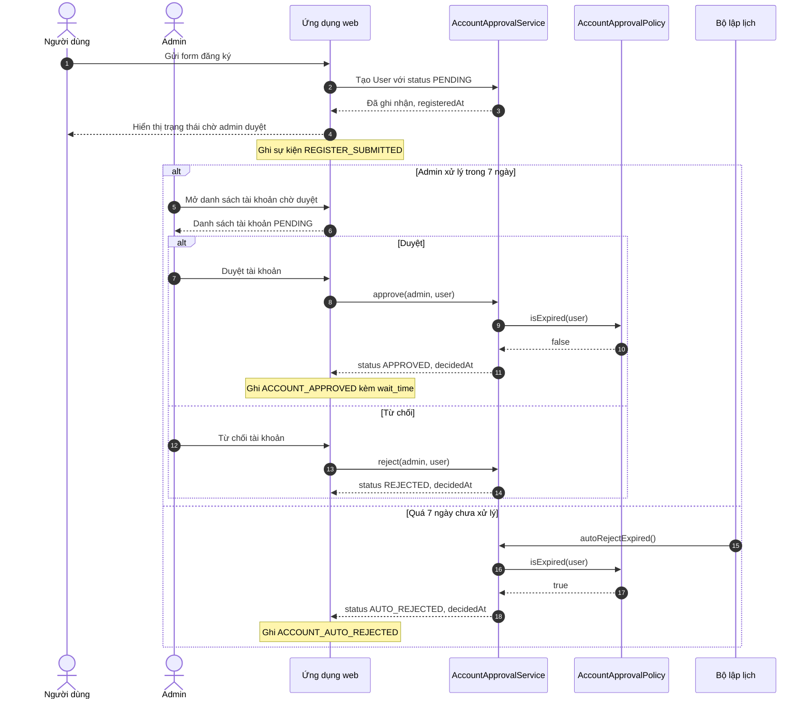
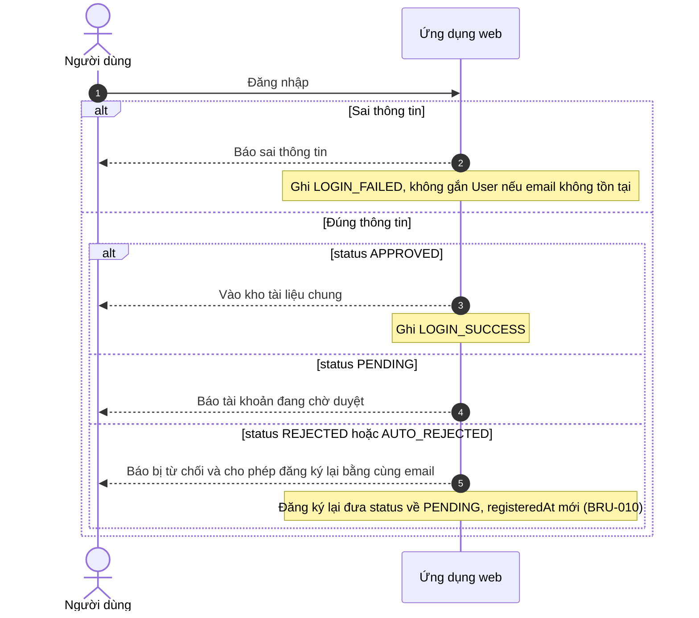
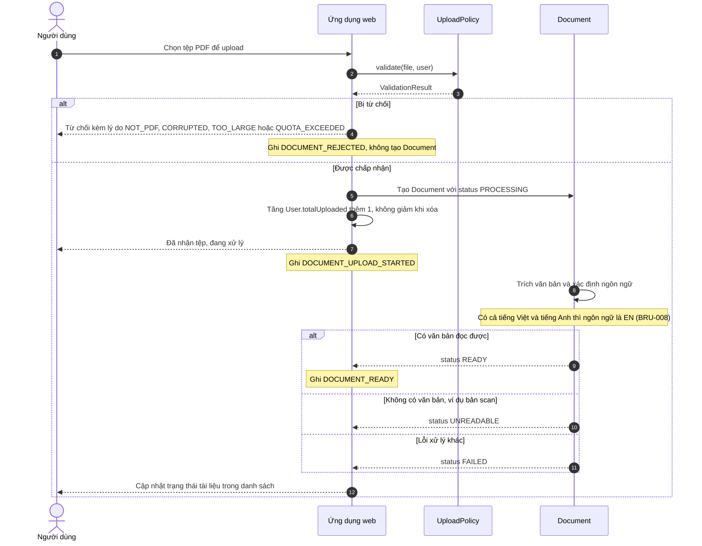
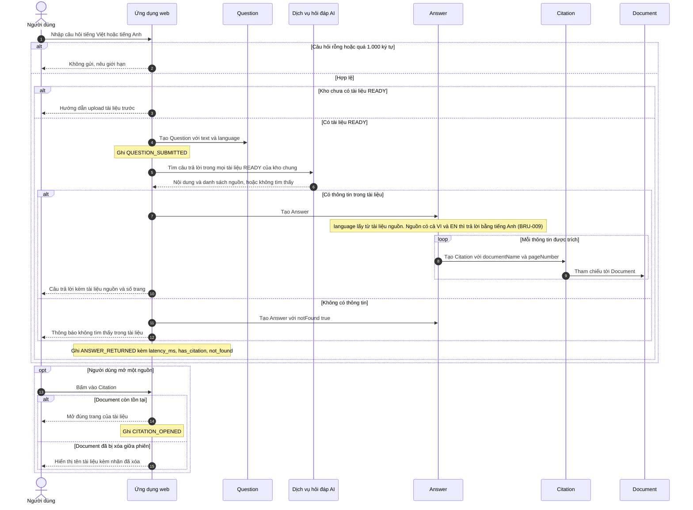
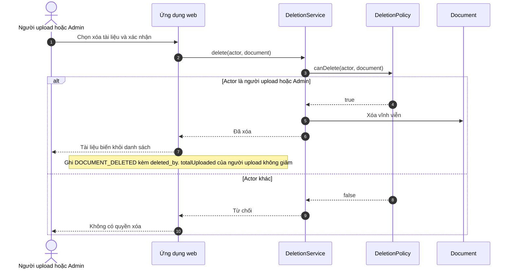

# Sequence diagrams — Chat với tài liệu (MVP)

> Mức: luồng nghiệp vụ giữa người dùng, ứng dụng web và các lớp trong `class-diagram.md`. Độc lập công nghệ: "Dịch vụ hỏi đáp AI" chỉ là vai trò (CON-004), chưa chọn sản phẩm. Chi tiết triển khai thuộc SAD.

## 0. Kiểm soát tài liệu

| Mục | Giá trị |
|---|---|
| Tiêu đề | Sequence diagrams — Chat với tài liệu (MVP) |
| Số tài liệu | SEQ-CDT-001 |
| Phiên bản | 0.1 |
| Trạng thái | Draft |
| Ngày | 2026-11-02 |
| Tác giả | Business Analyst |
| Đầu vào | `BRD.md` v0.11, `PRD.md` v0.5, `class-diagram.md` v0.6 |

## 1. Luồng 1 — Tự đăng ký và duyệt tài khoản

Truy vết: US-001, US-003, US-016 | BR-018, BR-020, BR-022, BRU-005, BRU-006, BRU-010.

### Đăng nhập (US-002)

## 2. Luồng 2 — Upload tài liệu

Truy vết: US-005, US-006, US-007 | BR-001, BR-002, BR-003, BR-004, BR-016, BRU-007, BRU-008.

Chỉ tài liệu `READY` được dùng để truy vấn (`Document.isQueryable()`). Tài liệu `UNREADABLE` và `FAILED` nằm trong danh sách để người dùng thấy và xóa.

## 3. Luồng 3 — Hỏi đáp

Truy vết: US-010, US-011, US-012, US-013 | BR-005, BR-006, BR-007, BR-008, BR-009, BR-011, BR-015, BR-021, BRU-002, BRU-008, BRU-009.

Câu hỏi và câu trả lời không được lưu (OQ-013). Khi tải lại trang hoặc đăng xuất, khung chat trống. Câu hỏi chạy lâu quá 30 giây vẫn hoàn tất, giao diện hiển thị trạng thái đang xử lý và cho phép hủy hoặc thử lại (PRD mục 4.2).

## 4. Luồng 4 — Xóa tài liệu

Truy vết: US-008, US-009 | BR-013, BR-017, BRU-003, BRU-004, BRU-007.

Từ truy vấn kế tiếp, tài liệu đã xóa không còn xuất hiện trong câu trả lời (AC-013, AC-017).

## 5. Quyết định tự áp dụng khi vẽ luồng

Theo ủy quyền của người yêu cầu ngày 2026-11-02 ("các câu hỏi phụ tự quyết định"), BA đã quyết định các câu hỏi phụ dưới đây. Đã ghi vào BRD, PRD và class diagram. Người yêu cầu có thể đảo lại bất kỳ quyết định nào.

| OQ | Quyết định | Lý do |
|---|---|---|
| OQ-025 | Nguồn gồm cả tài liệu tiếng Việt và tiếng Anh thì trả lời bằng tiếng Anh (BRU-009) | Nhất quán với BRU-008: tài liệu trộn cũng coi là tiếng Anh |
| OQ-023 | Câu hỏi tối đa 1.000 ký tự | Đủ cho câu hỏi thông thường, tránh câu hỏi quá dài làm chậm phản hồi. Con số là giả định, điều chỉnh được khi có dữ liệu pilot |
| OQ-024 | Không ghi nội dung câu hỏi và câu trả lời. Bỏ sự kiện EVT-009 (phản hồi đúng/sai) khỏi MVP | Khớp quyết định không lưu lịch sử (OQ-013). MET-003 đo bằng bộ câu hỏi chuẩn. Hạn 14 ngày không cho thêm story mới |
| OQ-026 | Người bị từ chối hoặc tự động từ chối được thông báo khi đăng nhập và đăng ký lại bằng cùng email (BRU-010). Không có admin dự phòng trong MVP, ghi RSK-008 | Giữ BR-019 (một tài khoản admin). Đăng ký lại giảm tác hại khi admin vắng |
| OQ-010 | Giữ nguyên danh sách ngoài phạm vi ở BRD mục 5 | Khớp SRC-001 và hạn 14 ngày |
| OQ-012 | Không thêm business objective mới | Các BR bảo mật và vận hành truy vết tới stakeholder need (SN-006, SN-007, SN-008) là đủ theo IEEE 29148 |

Còn mở, không quyết định thay được: **OQ-015** (ai review độc lập) và **OQ-017** (số tài liệu hiện có và tốc độ tăng, cần dữ liệu).

## 6. Bước tiếp theo

- Các luồng đủ để bắt đầu kiến trúc (SAD): chọn công nghệ cho ứng dụng web, lưu trữ, xử lý PDF và dịch vụ hỏi đáp AI.
- Render Mermaid để kiểm tra cú pháp (chưa kiểm tra bằng công cụ).
