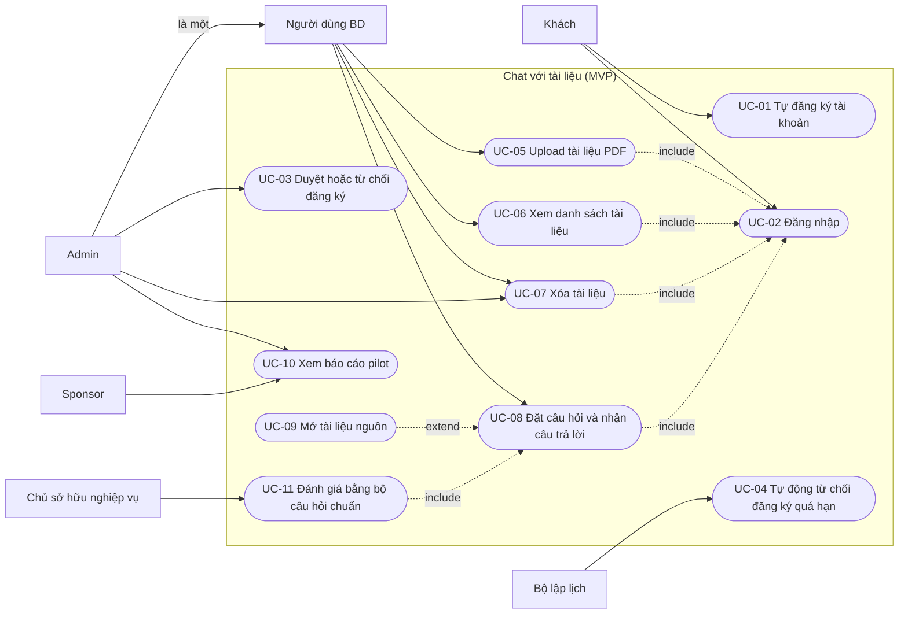

# Use cases — Chat với tài liệu (MVP)

> Mức: use case ở ranh giới hệ thống, độc lập công nghệ. Mỗi use case truy vết về user story (US), business requirement (BR) và business rule (BRU).
> Dùng chung ID, tên lớp và trạng thái với `class-diagram.md` và `sequence-diagrams.md`.

## 0. Kiểm soát tài liệu

| Mục | Giá trị |
|---|---|
| Tiêu đề | Use cases — Chat với tài liệu (MVP) |
| Số tài liệu | UCS-CDT-001 |
| Phiên bản | 0.1 |
| Trạng thái | Draft |
| Ngày | 2026-11-02 |
| Tác giả | Business Analyst |
| Đầu vào | `BRD.md` v0.11, `PRD.md` v0.5, `class-diagram.md` v0.6, `sequence-diagrams.md` v0.1 |

## 1. Tác nhân (actor)

| Actor | Mô tả | Nguồn |
|---|---|---|
| Khách | Người chưa có tài khoản hoặc chưa đăng nhập | US-001, US-002 |
| Người dùng BD | Thành viên đội BD đã được duyệt (`role = MEMBER`, `status = APPROVED`) | PER-01 |
| Người upload | Người dùng BD đã upload một tài liệu cụ thể. Vai trò theo từng tài liệu | BRU-004 |
| Admin | Người dùng có `role = ADMIN`. Thừa hưởng mọi quyền của Người dùng BD | PER-02, BR-019 |
| Bộ lập lịch | Tác nhân hệ thống, kích hoạt việc định kỳ | BR-022 |
| Sponsor | Người yêu cầu MVP, cần số liệu để quyết định tiếp tục | PER-03 |
| Chủ sở hữu nghiệp vụ | Người chấm bộ câu hỏi chuẩn (business owner, hiện là BA) | BR-010 |

## 2. Sơ đồ use case

Mermaid không có sơ đồ use case riêng, nên dùng flowchart: hình chữ nhật là actor, hình bầu dục là use case.

Ghi chú:
- Các use case UC-05..UC-09 yêu cầu đã đăng nhập (UC-02), thể hiện bằng quan hệ include.
- Sponsor không có tài khoản riêng trong MVP. Số liệu pilot do Admin xem rồi chuyển cho Sponsor (giả định G-1, mục 5).
- Tài khoản admin có sẵn (US-004, BR-019) là điều kiện triển khai, không phải use case.

## 3. Danh sách use case

| ID | Tên | Actor chính | Ưu tiên | US | BR |
|---|---|---|---|---|---|
| UC-01 | Tự đăng ký tài khoản | Khách | P0 | US-001 | BR-018 |
| UC-02 | Đăng nhập | Khách | P0 | US-002 | BR-012 |
| UC-03 | Duyệt hoặc từ chối đăng ký | Admin | P0 | US-003 | BR-020 |
| UC-04 | Tự động từ chối đăng ký quá hạn | Bộ lập lịch | P1 | US-016 | BR-022 |
| UC-05 | Upload tài liệu PDF | Người dùng BD | P0 | US-005, US-006 | BR-001, BR-002, BR-003, BR-016 |
| UC-06 | Xem danh sách tài liệu | Người dùng BD | P0 | US-007 | BR-004 |
| UC-07 | Xóa tài liệu | Người upload, Admin | P0 | US-008, US-009 | BR-013, BR-017 |
| UC-08 | Đặt câu hỏi và nhận câu trả lời | Người dùng BD | P0 | US-010, US-011, US-012, US-013 | BR-005..BR-009, BR-011, BR-015, BR-021 |
| UC-09 | Mở tài liệu nguồn | Người dùng BD | P0 | US-011 | BR-008 |
| UC-10 | Xem báo cáo pilot | Admin | P0 | US-015 | BR-014 |
| UC-11 | Đánh giá bằng bộ câu hỏi chuẩn | Chủ sở hữu nghiệp vụ | P0 | NFR-002 | BR-010, BR-014 |

## 4. Đặc tả use case

### UC-01 — Tự đăng ký tài khoản

| Mục | Nội dung |
|---|---|
| Actor chính | Khách |
| Mục tiêu | Có tài khoản để dùng công cụ mà không cần ai tạo hộ |
| Tiền điều kiện | Chưa có tài khoản, hoặc tài khoản đang `REJECTED` hoặc `AUTO_REJECTED` |
| Kích hoạt | Khách chọn đăng ký |
| Hậu điều kiện (thành công) | `User.status = PENDING`, `registeredAt` được ghi. Chưa đăng nhập được |
| Quy tắc | BRU-005, BRU-006, BRU-010 |

**Luồng chính**
1. Khách mở trang đăng ký.
2. Khách nhập email, tên hiển thị và thông tin xác thực.
3. Hệ thống kiểm tra dữ liệu hợp lệ.
4. Hệ thống tạo `User` với `status = PENDING`.
5. Hệ thống hiển thị "chờ admin duyệt, tối đa 7 ngày".
6. Hệ thống ghi sự kiện `REGISTER_SUBMITTED`.

**Luồng thay thế**
- 3a. Dữ liệu không hợp lệ: hệ thống báo lỗi và giữ lại dữ liệu đã nhập.
- 3b. Email đã thuộc tài khoản `PENDING` hoặc `APPROVED`: hệ thống báo đã tồn tại, không tạo mới.
- 3c. Email thuộc tài khoản `REJECTED` hoặc `AUTO_REJECTED`: hệ thống đưa `status` về `PENDING` và đặt `registeredAt` mới (BRU-010).

**Ngoại lệ:** lỗi hệ thống hoặc mất mạng khi gửi: báo không gửi được, giữ dữ liệu để gửi lại.

### UC-02 — Đăng nhập

| Mục | Nội dung |
|---|---|
| Actor chính | Khách |
| Mục tiêu | Vào kho tài liệu chung |
| Tiền điều kiện | Đã có tài khoản |
| Kích hoạt | Khách đăng nhập, hoặc mở bất kỳ trang nào của kho khi chưa đăng nhập |
| Hậu điều kiện (thành công) | Phiên đăng nhập được tạo, Khách trở thành Người dùng BD |
| Quy tắc | BRU-001, BRU-005 |

**Luồng chính**
1. Khách nhập thông tin đăng nhập.
2. Hệ thống xác thực thông tin.
3. Hệ thống kiểm tra `status = APPROVED`.
4. Hệ thống tạo phiên và mở kho tài liệu chung.
5. Hệ thống ghi `LOGIN_SUCCESS`.

**Luồng thay thế**
- 2a. Sai thông tin: báo sai thông tin, ghi `LOGIN_FAILED`. Không gắn User nếu email không tồn tại.
- 3a. `PENDING`: báo tài khoản đang chờ duyệt.
- 3b. `REJECTED` hoặc `AUTO_REJECTED`: báo bị từ chối và gợi ý đăng ký lại (UC-01, bước 3c).
- 1a. Khách mở trang của kho khi chưa đăng nhập: chuyển tới trang đăng nhập, không hiển thị nội dung kho.

**Ngoại lệ:** phiên hết hạn trong lúc dùng: quay lại trang đăng nhập, giữ câu hỏi chưa gửi nếu có thể (PRD mục 4.2).

### UC-03 — Duyệt hoặc từ chối đăng ký

| Mục | Nội dung |
|---|---|
| Actor chính | Admin |
| Mục tiêu | Chỉ người đúng mới vào được kho |
| Tiền điều kiện | Admin đã đăng nhập; có tài khoản `PENDING` |
| Kích hoạt | Admin mở danh sách tài khoản chờ duyệt |
| Hậu điều kiện (thành công) | `status` thành `APPROVED` hoặc `REJECTED`, `decidedAt` được ghi |
| Quy tắc | BRU-005, BRU-006 |

**Luồng chính**
1. Admin mở danh sách tài khoản `PENDING`.
2. Hệ thống hiển thị danh sách kèm ngày đăng ký.
3. Admin chọn một tài khoản và chọn duyệt.
4. Hệ thống đặt `status = APPROVED`, ghi `decidedAt`.
5. Hệ thống ghi `ACCOUNT_APPROVED` kèm `wait_time`.

**Luồng thay thế**
- 3a. Admin chọn từ chối: hệ thống đặt `status = REJECTED`, ghi `decidedAt`.
- 2a. Không có tài khoản chờ duyệt: hệ thống hiển thị trạng thái trống.
- 3b. Tài khoản đã bị tự động từ chối (UC-04) trước khi Admin xử lý: không còn trong danh sách chờ.

**Ngoại lệ:** Admin không phải `ADMIN`: không thấy mục quản trị.

### UC-04 — Tự động từ chối đăng ký quá hạn

| Mục | Nội dung |
|---|---|
| Actor chính | Bộ lập lịch |
| Mục tiêu | Hàng đợi duyệt không tồn đọng |
| Tiền điều kiện | Có tài khoản `PENDING` |
| Kích hoạt | Định kỳ, ít nhất mỗi ngày một lần `[Proposed]` |
| Hậu điều kiện (thành công) | Tài khoản quá 7 ngày chuyển sang `AUTO_REJECTED` |
| Quy tắc | BRU-006, `AccountApprovalPolicy.expiryDays = 7` |

**Luồng chính**
1. Bộ lập lịch kích hoạt `autoRejectExpired()`.
2. Hệ thống tìm các tài khoản `PENDING` có `registeredAt` cách hiện tại hơn 7 ngày.
3. Hệ thống đặt `status = AUTO_REJECTED`, ghi `decidedAt`.
4. Hệ thống ghi `ACCOUNT_AUTO_REJECTED`.

**Luồng thay thế**
- 2a. Không có tài khoản quá hạn: không làm gì.
- 2b. Tài khoản được duyệt trước hạn: không bị ảnh hưởng.

### UC-05 — Upload tài liệu PDF

| Mục | Nội dung |
|---|---|
| Actor chính | Người dùng BD |
| Mục tiêu | Đưa PDF vào kho chung để cả đội hỏi đáp |
| Tiền điều kiện | Đã đăng nhập |
| Kích hoạt | Người dùng chọn tệp để upload |
| Hậu điều kiện (thành công) | Có `Document` ở trạng thái `READY`; `User.totalUploaded` tăng 1 |
| Quy tắc | BRU-007 (hạn mức 100 tệp tính tổng đã upload), BRU-008 (ngôn ngữ) |
| Chất lượng | Tối đa 100 MB mỗi tệp |

**Luồng chính**
1. Người dùng chọn tệp PDF.
2. Hệ thống kiểm tra qua `UploadPolicy.validate`: đúng định dạng PDF, không hỏng, không quá 100 MB, `totalUploaded` dưới 100.
3. Hệ thống tạo `Document` với `status = PROCESSING` và tăng `totalUploaded`.
4. Hệ thống báo đã nhận tệp, đang xử lý. Ghi `DOCUMENT_UPLOAD_STARTED`.
5. Hệ thống trích văn bản và xác định ngôn ngữ (cả hai ngôn ngữ thì là tiếng Anh).
6. Hệ thống đặt `status = READY` và ghi `DOCUMENT_READY`.
7. Hệ thống cập nhật trạng thái trong danh sách.

**Luồng thay thế**
- 2a. Từ chối: `NOT_PDF`, `CORRUPTED`, `TOO_LARGE` hoặc `QUOTA_EXCEEDED`. Hệ thống nêu lý do cụ thể (BR-003), ghi `DOCUMENT_REJECTED`, không tạo `Document`.
- 2b. Hạn mức đã dùng hết dù đã xóa một số tệp: vẫn `QUOTA_EXCEEDED` (BRU-007).
- 6a. PDF không có văn bản đọc được (bản scan): `status = UNREADABLE`. Tài liệu nằm trong danh sách nhưng không dùng để truy vấn.
- 6b. Lỗi xử lý khác: `status = FAILED`.

**Ngoại lệ:** mất mạng khi upload: báo lỗi, giữ tệp trong form để thử lại, không tạo tài liệu hỏng trong kho.

### UC-06 — Xem danh sách tài liệu

| Mục | Nội dung |
|---|---|
| Actor chính | Người dùng BD |
| Mục tiêu | Biết kho có những tài liệu nào và trạng thái của chúng |
| Tiền điều kiện | Đã đăng nhập |
| Kích hoạt | Người dùng mở trang chính |
| Hậu điều kiện (thành công) | Danh sách hiển thị đủ tài liệu hiện có của kho chung |
| Quy tắc | BRU-001, BRU-003 |

**Luồng chính**
1. Người dùng mở trang chính.
2. Hệ thống hiển thị mọi `Document` trong kho: tên, dung lượng, ngôn ngữ, trạng thái, người upload, ngày upload.
3. Tài liệu còn đó sau khi đăng xuất và đăng nhập lại, cho đến khi bị xóa (BR-004).

**Luồng thay thế**
- 2a. Kho trống: hiển thị hướng dẫn "Upload PDF để bắt đầu" và vô hiệu hóa ô hỏi.
- 2b. Có tài liệu `PROCESSING`, `UNREADABLE` hoặc `FAILED`: hiển thị trạng thái tương ứng.

### UC-07 — Xóa tài liệu

| Mục | Nội dung |
|---|---|
| Actor chính | Người upload hoặc Admin |
| Mục tiêu | Loại bỏ một tài liệu khỏi kho |
| Tiền điều kiện | Đã đăng nhập; tài liệu tồn tại |
| Kích hoạt | Actor chọn xóa tài liệu |
| Hậu điều kiện (thành công) | Tài liệu bị xóa vĩnh viễn. Không xuất hiện trong câu trả lời từ truy vấn kế tiếp. `totalUploaded` không giảm |
| Quy tắc | BRU-003, BRU-004, BRU-007 |

**Luồng chính**
1. Actor chọn xóa một tài liệu.
2. Hệ thống yêu cầu xác nhận vì xóa là vĩnh viễn.
3. Actor xác nhận.
4. Hệ thống kiểm tra `DeletionPolicy.canDelete`: actor là người upload hoặc Admin.
5. Hệ thống xóa tài liệu.
6. Hệ thống ghi `DOCUMENT_DELETED` kèm `deleted_by`.
7. Tài liệu biến khỏi danh sách.

**Luồng thay thế**
- 3a. Actor hủy ở bước xác nhận: không xóa.
- 4a. Actor không phải người upload và không phải Admin: hệ thống không cung cấp hành động xóa, và từ chối nếu yêu cầu vẫn được gửi.

**Ngoại lệ:** Citation trong câu trả lời đang hiển thị trỏ tới tài liệu vừa xóa: hiển thị tên tài liệu kèm nhãn "đã xóa" (UC-09).

### UC-08 — Đặt câu hỏi và nhận câu trả lời

| Mục | Nội dung |
|---|---|
| Actor chính | Người dùng BD |
| Mục tiêu | Có câu trả lời đúng, kiểm chứng được, từ nội dung các tài liệu trong kho |
| Tiền điều kiện | Đã đăng nhập; kho có ít nhất một `Document` ở trạng thái `READY` |
| Kích hoạt | Người dùng gửi câu hỏi |
| Hậu điều kiện (thành công) | Người dùng nhận `Answer` kèm `Citation`, hoặc thông báo không tìm thấy |
| Quy tắc | BRU-002, BRU-008, BRU-009 |
| Chất lượng | Tối đa 30 giây cho 90% câu hỏi (BR-009). Độ chính xác từ 90% trên bộ câu hỏi chuẩn (BR-010) |

**Luồng chính**
1. Người dùng nhập câu hỏi bằng tiếng Việt hoặc tiếng Anh.
2. Hệ thống kiểm tra câu hỏi không rỗng và không quá 1.000 ký tự.
3. Hệ thống tạo `Question`. Ghi `QUESTION_SUBMITTED`.
4. Hệ thống tìm trong mọi tài liệu `READY` của kho chung (BR-006).
5. Hệ thống tạo `Answer` dựa trên nội dung tài liệu, với ngôn ngữ của tài liệu nguồn.
6. Hệ thống tạo `Citation` (tên tài liệu và số trang) cho mỗi thông tin được trích.
7. Hệ thống hiển thị câu trả lời kèm nguồn.
8. Hệ thống ghi `ANSWER_RETURNED` kèm `latency_ms`, `has_citation`, `not_found`.

**Luồng thay thế**
- 1a. Kho chưa có tài liệu `READY`: hướng dẫn upload tài liệu trước, không gửi câu hỏi.
- 2a. Câu hỏi rỗng hoặc quá dài: không gửi, nêu giới hạn.
- 5a. Không có thông tin trong tài liệu: `Answer.notFound = true`, hiển thị "không tìm thấy trong tài liệu", không đưa nội dung không có căn cứ (BR-007).
- 5b. Thông tin nằm ở nhiều tài liệu: câu trả lời phản ánh cả các tài liệu đó.
- 5c. Nguồn gồm cả tài liệu tiếng Việt và tiếng Anh: trả lời bằng tiếng Anh (BRU-009).
- 5d. Câu hỏi bằng tiếng Anh về tài liệu tiếng Việt: câu trả lời bằng tiếng Việt, và ngược lại (BR-021).
- 7a. Chờ quá 30 giây: hiển thị đang xử lý lâu, cho phép hủy hoặc thử lại.

**Ngoại lệ**
- Mất mạng khi gửi: báo không gửi được, giữ câu hỏi trong ô nhập.
- Dịch vụ hỏi đáp lỗi: báo lỗi, cho phép gửi lại, giữ câu hỏi.

Câu hỏi và câu trả lời không được lưu. Tải lại trang hoặc đăng xuất thì khung chat trống (OQ-013).

### UC-09 — Mở tài liệu nguồn

| Mục | Nội dung |
|---|---|
| Actor chính | Người dùng BD |
| Mục tiêu | Kiểm chứng thông tin trong câu trả lời |
| Tiền điều kiện | Có câu trả lời với ít nhất một `Citation` đang hiển thị |
| Kích hoạt | Người dùng bấm vào một nguồn |
| Quan hệ | Mở rộng (extend) UC-08 |
| Hậu điều kiện (thành công) | Tài liệu mở đúng trang được trích |

**Luồng chính**
1. Người dùng bấm vào một `Citation`.
2. Hệ thống mở tài liệu ở `pageNumber` tương ứng.
3. Hệ thống ghi `CITATION_OPENED`.

**Luồng thay thế**
- 2a. `Document` đã bị xóa giữa phiên: hiển thị `documentName` kèm nhãn "đã xóa", không mở được nguồn.

### UC-10 — Xem báo cáo pilot

| Mục | Nội dung |
|---|---|
| Actor chính | Admin (chuyển số liệu cho Sponsor) |
| Mục tiêu | Có số liệu để quyết định tiếp tục MVP |
| Tiền điều kiện | Pilot đang chạy hoặc đã kết thúc (2026-11-03 đến 2027-01-02) |
| Kích hoạt | Admin mở báo cáo |
| Hậu điều kiện (thành công) | Admin thấy số liệu theo tuần |

**Luồng chính**
1. Admin mở báo cáo pilot.
2. Hệ thống hiển thị theo tuần:
   - MET-002: số người dùng có ít nhất một câu hỏi trong tuần chia cho 30.
   - Số đăng ký, số được duyệt, số tự động từ chối, thời gian chờ duyệt.
   - Số tài liệu upload, số bị từ chối và lý do.
   - Phân bố thời gian trả lời, tỷ lệ câu trả lời có nguồn, tỷ lệ không tìm thấy.
3. Admin chuyển số liệu cho Sponsor.

**Luồng thay thế**
- 2a. Chưa có dữ liệu: hiển thị trạng thái trống.

**Giới hạn:** MET-001 (thời gian tìm thông tin) không có trong báo cáo này. Nó đo bằng nghiên cứu tác vụ mẫu (PRD mục 5.2). MET-003 do UC-11.

### UC-11 — Đánh giá bằng bộ câu hỏi chuẩn

| Mục | Nội dung |
|---|---|
| Actor chính | Chủ sở hữu nghiệp vụ |
| Mục tiêu | Đo độ chính xác (MET-003) và chứng minh cổng G2 |
| Tiền điều kiện | Có bộ `GoldenQuestion` gồm cả tiếng Việt và tiếng Anh (DEP-002); tài liệu mẫu đã ở trạng thái `READY` trong kho |
| Kích hoạt | Trước khi bắt đầu pilot và định kỳ trong pilot |
| Quan hệ | Dùng UC-08 (include) |
| Hậu điều kiện (thành công) | Có `EvaluationRun` với `accuracy` so với ngưỡng 90% |

**Luồng chính**
1. Chủ sở hữu nghiệp vụ chạy từng `GoldenQuestion` qua UC-08.
2. Với mỗi câu, chủ sở hữu so câu trả lời với `expectedAnswer` và chấm đúng hoặc sai, ghi `EvaluationResult`.
3. Hệ thống tính `accuracy = correctCount / totalQuestions` và lưu `EvaluationRun`.
4. Chủ sở hữu so `accuracy` với ngưỡng 90%.

**Luồng thay thế**
- 1a. Bộ câu hỏi thiếu tiếng Việt hoặc tiếng Anh: không kết luận G2 (G2 yêu cầu đủ cả hai).
- 4a. `accuracy` dưới 90%: G2 không đạt, ghi nhận để sửa trước khi phát hành.

Use case này suy ra từ BR-010 và NFR-002, chưa có user story riêng trong PRD `[Proposed]`.

## 5. Giả định và ghi chú

| ID | Nội dung |
|---|---|
| G-1 | Sponsor không có tài khoản riêng trong MVP. Admin xem báo cáo (UC-10) rồi chuyển cho Sponsor. Nếu Sponsor cần tự xem, cần thêm vai trò mới (ngoài phạm vi, BRD mục 5). Quyết định theo ủy quyền của người yêu cầu |
| G-2 | UC-04 chạy ít nhất mỗi ngày một lần. Con số này là đề xuất, không có trong BRD |
| G-3 | Admin được hiểu là một Người dùng BD, nên làm được mọi việc của Người dùng BD (UC-05..UC-09) |
| G-4 | UC-11 không có user story. Nên bổ sung story vào PRD nếu giữ use case này |

## 6. Truy vết

### 6.1 User story → use case

| US | UC | US | UC |
|---|---|---|---|
| US-001 | UC-01 | US-009 | UC-07 |
| US-002 | UC-02 | US-010 | UC-08 |
| US-003 | UC-03 | US-011 | UC-08, UC-09 |
| US-004 | Điều kiện triển khai, không phải use case | US-012 | UC-08 |
| US-005 | UC-05 | US-013 | UC-08 |
| US-006 | UC-05 (luồng 2a) | US-014 | Không có (Won't, OQ-013) |
| US-007 | UC-06 | US-015 | UC-10 |
| US-008 | UC-07 | US-016 | UC-04 |

### 6.2 Business requirement → use case

| BR | UC | BR | UC |
|---|---|---|---|
| BR-001 | UC-05 | BR-012 | UC-02 |
| BR-002 | UC-05 | BR-013 | UC-07 |
| BR-003 | UC-05 | BR-014 | UC-10, UC-11 |
| BR-004 | UC-06 | BR-015 | UC-08 |
| BR-005 | UC-08 | BR-016 | UC-05 |
| BR-006 | UC-08 | BR-017 | UC-07 |
| BR-007 | UC-08 | BR-018 | UC-01 |
| BR-008 | UC-08, UC-09 | BR-019 | Điều kiện triển khai |
| BR-009 | UC-08 | BR-020 | UC-03 |
| BR-010 | UC-11 | BR-021 | UC-08 |
| BR-011 | UC-08 | BR-022 | UC-04 |

Coverage: 21 trong 22 BR có use case. BR-019 là điều kiện triển khai (tài khoản admin có sẵn khi vận hành), kiểm tra qua AC-019 chứ không qua use case.

## 7. Bước tiếp theo

- Xác nhận giả định G-1 (Sponsor không có tài khoản) và G-4 (thêm story cho UC-11).
- Từ các use case có thể viết test case (mỗi luồng chính và luồng thay thế là một ca thử), rồi dùng skill `test-report` để lập báo cáo kiểm thử.
- Render Mermaid để kiểm tra cú pháp (chưa kiểm tra bằng công cụ).
