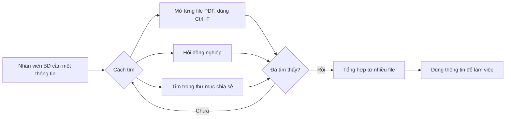
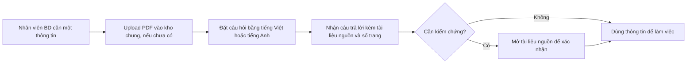

# Business Requirements Document (BRD) — Chat với tài liệu (MVP)

> Chuẩn áp dụng: IEEE 29148-2018. Prompt nguồn: `docs/BRD_Prompt_IEEE_standard.md`.
> Quy ước: `[TBD: OQ-xxx]` = thông tin chưa có, đã tạo câu hỏi mở. `[Unverified]` = chưa có nguồn xác nhận độc lập.

---

## 0. Tóm tắt kiểm tra đầu vào

**Đầu vào nhận được:**
- SRC-001: bối cảnh và mục tiêu (mục 2.1 của prompt).
- SRC-002: câu trả lời của người yêu cầu cho bộ câu hỏi làm rõ, ngày 2026-10-20. Gồm tổ chức, vai trò, quy trình hiện tại, lý do làm, quy mô, baseline, target, giới hạn, ngôn ngữ, lưu giữ, kho chung.
- SRC-003: câu trả lời vòng 2 của người yêu cầu, ngày 2026-10-20. Gồm ngân sách, đăng nhập, mức mật của tài liệu, quyền xóa.
- SRC-004: câu trả lời vòng 3 của người yêu cầu, ngày 2026-10-20. Gồm hạn 14 ngày, tự đăng ký tài khoản, tài khoản admin có sẵn.
- SRC-005: câu trả lời vòng 4 của người yêu cầu, ngày 2026-10-20. Gồm admin duyệt tài khoản đăng ký, pilot bắt đầu sau 14 ngày.
- SRC-006: câu trả lời vòng 5 của người yêu cầu, ngày 2026-10-20. Pilot kéo dài 60 ngày.
- SRC-007: câu trả lời vòng 6 của người yêu cầu khi viết PRD, ngày 2026-10-20. Xác nhận trụ cột UX, ngôn ngữ câu trả lời, thời hạn duyệt tài khoản.

**Còn thiếu:**
- Phạm vi loại trừ chưa được xác nhận (OQ-010).
- Lịch sử chat (OQ-013).
- Mục tiêu độ tin cậy và bảo mật (OQ-012).
- Ngôn ngữ câu trả lời khi nguồn gồm nhiều tài liệu khác ngôn ngữ nhau (OQ-025).
- Người phê duyệt độc lập (OQ-015).
- Tốc độ tăng tài liệu (OQ-017).

**Ba rủi ro hàng đầu đối với chất lượng yêu cầu:**
1. Baseline và target đều là ước lượng của người yêu cầu, chưa được đo (ASM-004, RSK-004). Cần xác nhận trước khi dùng để nghiệm thu.
2. Hạn 14 ngày rất gấp so với 22 requirement (RSK-006). Pilot kéo dài 60 ngày, từ 2026-11-03 đến 2027-01-02 (SRC-006).
3. Một người (BA) đảm nhận mọi vai trò: tác giả, sponsor, business owner, approver. Không có xác nhận độc lập (RSK-005, OQ-015).

---

## 1. Document control

| Mục | Giá trị |
|---|---|
| Tiêu đề | BRD — Công cụ "Chat với tài liệu" (MVP) |
| Số tài liệu | BRD-CDT-001 |
| Tổ chức | DEMO_SDLC (SRC-002) |
| Phiên bản | 0.8 |
| Trạng thái | In review |
| Tác giả | Business Analyst |
| Executive sponsor, business owner, problem owner | Business Analyst (theo SRC-002) |
| Người review, người phê duyệt | Business Analyst (theo SRC-002); xem OQ-015 |
| Phân loại bảo mật | Nội bộ `[Unverified]` |
| Danh sách phân phối | Đội phát triển kinh doanh `[Unverified]` |

| Phiên bản | Ngày | Tác giả | Tóm tắt thay đổi |
|---|---|---|---|
| 0.1 | 2026-10-20 | Business Analyst | Bản nháp đầu tiên từ SRC-001 |
| 0.2 | 2026-10-20 | Business Analyst | Bổ sung SRC-002: baseline, target, giới hạn, kho chung, ngôn ngữ, lưu giữ; thêm BR-015, BR-016; thêm OQ-014..OQ-017 |
| 0.3 | 2026-10-20 | Business Analyst | Bổ sung SRC-003: ngân sách tối thiểu hóa, bắt buộc đăng nhập, tài liệu không mật nhưng không công khai rộng, quyền xóa (người upload và admin); sửa BR-012, BR-013; thêm BR-017, SN-007, STK-006, OQ-018; đóng OQ-008, OQ-009, OQ-016 |
| 0.4 | 2026-10-20 | Business Analyst | Bổ sung SRC-004: hạn 14 ngày (2026-11-03), tự đăng ký tài khoản, một tài khoản admin có sẵn; sửa BR-012; thêm BR-018, BR-019, SN-008, ASM-005, RSK-006, OQ-019, OQ-020; đóng OQ-004, OQ-018 |
| 0.5 | 2026-10-20 | Business Analyst | Bổ sung SRC-005: admin duyệt tài khoản tự đăng ký, pilot bắt đầu sau 14 ngày; thêm BR-020, BRU-005, OQ-021; sửa ASM-005, RSK-002, CON-005; đóng OQ-019, OQ-020 |
| 0.6 | 2026-10-20 | Business Analyst | Bổ sung SRC-006: pilot kéo dài 60 ngày, từ 2026-11-03 đến 2027-01-02; điền timeframe cho BO-001..003; đóng OQ-021 |
| 0.7 | 2026-10-20 | Business Analyst | Chuyển trạng thái sang In review theo quyết định của người yêu cầu; OQ-010, OQ-012..OQ-017 và các assumption ASM-003..ASM-005 còn mở |
| 0.8 | 2026-10-20 | Business Analyst | Đồng bộ với PRD, bổ sung SRC-007: câu trả lời theo ngôn ngữ tài liệu (BR-021), admin duyệt tối đa 7 ngày và quá hạn tự động từ chối (BR-022, BRU-006); thêm OQ-022..OQ-026; đóng OQ-014 |

---

## 2. Executive summary

**Vấn đề.** Đội phát triển kinh doanh (khoảng 30 người) tìm thông tin trong PDF bằng cách mở từng file và dùng Ctrl+F, hỏi đồng nghiệp, hoặc tìm trong thư mục chia sẻ. Mỗi lần tìm mất khoảng 10–15 phút, 5–10 lần mỗi người mỗi ngày (SRC-002). Ước tính 25–75 giờ công mỗi ngày dành cho việc này `[Unverified]`. Tài liệu đang tăng nhanh (SRC-002).

**Thay đổi kinh doanh đề xuất.** Quản lý yêu cầu một MVP "Chat với tài liệu" (SRC-001). Người dùng upload PDF vào một kho chung và hỏi đáp về nội dung các tài liệu đã upload, thay vì mở từng file để tìm.

**Lợi ích kỳ vọng và metric chứng minh.**
- Giảm thời gian tìm một thông tin từ 15 phút xuống 3 phút (MET-001).
- 70% người dùng dùng hàng tuần (MET-002).
- Độ chính xác câu trả lời từ 90% trở lên (MET-003).
- Nếu đạt, tiết kiệm ước tính 30–60 giờ công mỗi ngày `[Unverified]`.

**Đầu tư, timeline, rủi ro.**
- Ngân sách: tối thiểu hóa chi phí, chưa có mức trần (SRC-003). Timeline: pilot bắt đầu 14 ngày sau 2026-10-20, tức 2026-11-03 (SRC-004, SRC-005), và kéo dài 60 ngày đến 2027-01-02 (SRC-006).
- Rủi ro chính: AI trả lời sai (RSK-001), tài liệu bị công khai ngoài đội BD (RSK-002), hạn 14 ngày gấp (RSK-006).

**Quyết định cần từ approver.** Duyệt phạm vi MVP (mục 5) và chốt các câu hỏi mở còn lại ở mục 12.

---

## 3. Business context và problem statement

### 3.1 Quy trình hiện tại (current state)

Nguồn: SRC-002. Các bước chi tiết hơn cần phỏng vấn người dùng (xem mục 3.5).

### 3.2 Quy trình mong muốn (proposed state)

### 3.3 Ai bị ảnh hưởng

Đội phát triển kinh doanh, khoảng 30 người. Mỗi người tìm thông tin trong PDF 5–10 lần mỗi ngày, mỗi lần 10–15 phút (SRC-002, ước lượng `[Unverified]`).

### 3.4 Chi phí của việc không làm

- Tổng thời gian tìm: 25–75 giờ công mỗi ngày (tính từ 30 người × 5–10 lần × 10–15 phút) `[Unverified]`.
- Khi tài liệu tăng nhanh, thời gian này sẽ tăng thêm. Tốc độ tăng chưa đo (OQ-017).
- Tác động doanh thu và rủi ro quyết định chậm: chưa định lượng `[TBD: OQ-017]`.

### 3.5 Nguyên nhân gốc và triệu chứng

| Loại | Nội dung | Nguồn |
|---|---|---|
| Triệu chứng | Mỗi lần tìm mất 10–15 phút | SRC-002 |
| Triệu chứng | Phải hỏi đồng nghiệp | SRC-002 |
| Nguyên nhân | Thông tin rải rác trong nhiều PDF, không có cách truy vấn chung | SRC-001, SRC-002 |
| Nguyên nhân | Khối lượng tài liệu tăng nhanh | SRC-002 |
| Hạn chế bằng chứng | Chưa phỏng vấn người dùng cuối; số liệu là ước lượng | ASM-004 |

### 3.6 Why now

Tài liệu tăng nhanh (SRC-002). Quản lý đã yêu cầu làm MVP (SRC-001). Tốc độ tăng cụ thể: `[TBD: OQ-017]`.

---

## 4. Business drivers và objectives

| ID | Business driver | Objective (outcome) | Metric | Baseline | Target | Timeframe | Source |
|---|---|---|---|---|---|---|---|
| BO-001 | Tìm thông tin tốn thời gian | Rút ngắn thời gian để tìm được một thông tin cần thiết từ tài liệu | MET-001 | 15 phút (khoảng 10–15) | 3 phút | Hết pilot (2027-01-02) | SRC-002 |
| BO-002 | Thông tin rải rác trong nhiều PDF | Người dùng lấy được thông tin xuyên nhiều tài liệu, chính xác từ 90% | MET-001, MET-003 | MET-003: chưa đo (công cụ mới) | MET-003 ≥ 90% | Hết pilot (2027-01-02) | SRC-001, SRC-002 |
| BO-003 | Quản lý yêu cầu MVP | Có bằng chứng sử dụng thực tế để quyết định tiếp tục, mở rộng hoặc dừng | MET-002 | 0% (công cụ mới) | 70% người dùng dùng hàng tuần | Hết pilot (2027-01-02) | SRC-001, SRC-002 |

### Định nghĩa metric

| ID | Định nghĩa | Công thức | Nguồn dữ liệu | Owner | Tần suất | Ngày baseline |
|---|---|---|---|---|---|---|
| MET-001 | Thời gian trung bình để một người dùng tìm được thông tin cần thiết | Tổng thời gian hoàn thành các tác vụ tìm mẫu / số tác vụ | Đo trên bộ tác vụ mẫu, trước và sau triển khai | Business Analyst | Trước pilot và cuối pilot `[Unverified]` | 2026-10-20 (ước lượng, chưa đo) |
| MET-002 | Tỷ lệ người dùng dùng hàng tuần trong pilot | Số người dùng hoạt động trong tuần / số người được cấp quyền (30) | Dữ liệu sử dụng của ứng dụng | Business Analyst | Hàng tuần `[Unverified]` | 2026-11-03 (ngày bắt đầu pilot) |
| MET-003 | Độ chính xác câu trả lời | Số câu trả lời đúng / tổng số câu hỏi trong bộ câu hỏi chuẩn | Bộ câu hỏi chuẩn do business owner xác nhận | Business Analyst | Trước mỗi lần phát hành pilot `[Unverified]` | Ngày chốt bộ câu hỏi |

> Baseline của MET-001 là ước lượng. Phải đo thực tế trước pilot (ASM-004, RSK-004). Timeframe: hết pilot ngày 2027-01-02 (SRC-006).

---

## 5. Scope

**Trong phạm vi (In scope):**
- Ứng dụng web (SRC-001).
- Upload tệp PDF vào kho tài liệu chung của đội BD (SRC-001, SRC-002).
- Hỏi đáp bằng AI về nội dung các tài liệu trong kho (SRC-001).
- Tài liệu và câu hỏi bằng tiếng Việt hoặc tiếng Anh (SRC-002).
- Người dùng: đội phát triển kinh doanh, khoảng 30 người (SRC-002).
- Đăng nhập bắt buộc để truy cập kho (SRC-003).
- Người dùng tự đăng ký tài khoản; admin duyệt tài khoản; một tài khoản admin có sẵn (SRC-004, SRC-005).
- Xóa tài liệu: người upload xóa tài liệu của mình; admin xóa mọi tài liệu (SRC-002, SRC-003).
- Đo lường sử dụng và chất lượng trong pilot (BO-003).

**Ngoài phạm vi (Out of scope) — đề xuất, chưa được xác nhận (OQ-010):**

| Hạng mục | Lý do |
|---|---|
| Định dạng khác PDF (Word, Excel, ảnh) | SRC-001 chỉ nêu PDF |
| Ứng dụng di động | SRC-001 chỉ nêu ứng dụng web |
| Tích hợp hệ thống nội bộ khác (CRM, DMS) | Không có trong SRC-001; MVP |
| Chỉnh sửa hoặc tạo tài liệu | Mục tiêu chỉ là truy vấn |

**Hoãn lại (Deferred):** để sau MVP — định dạng khác, tích hợp hệ thống khác, báo cáo nâng cao `[Unverified]`.

**Ranh giới:** bắt đầu từ lúc người dùng tải PDF lên, kết thúc khi người dùng nhận câu trả lời. Không bao gồm quy trình quản lý tài liệu gốc của tổ chức.

---

## 6. Stakeholders và needs

| ID | Nhóm | Vai trò | Mối quan tâm | Ảnh hưởng | Needs | Nguồn |
|---|---|---|---|---|---|---|
| STK-001 | Đội phát triển kinh doanh (khoảng 30 người) | Người dùng chính | Tìm thông tin nhanh, đáng tin | Cao (quyết định áp dụng) | SN-001, SN-002, SN-003, SN-004, SN-008 | SRC-001, SRC-002, SRC-004 |
| STK-002 | Quản lý | Người yêu cầu MVP | Chứng minh giá trị MVP | Cao | SN-005 | SRC-001 |
| STK-003 | IT / bảo mật `[Unverified]` | Vận hành và duyệt dịch vụ AI | Tài liệu không bị công khai rộng | Trung bình (có thể chặn) | SN-006 | SRC-003 |
| STK-004 | Chủ sở hữu tài liệu / pháp chế `[Unverified]` | Kiểm soát chia sẻ tài liệu | Tuân thủ chia sẻ nội dung | Thấp–Trung bình | SN-006 | SRC-003 |
| STK-005 | Nhân viên BD quen cách cũ `[Unverified]` | Stakeholder phản đối tiềm năng | Giữ thói quen Ctrl+F và hỏi đồng nghiệp | Trung bình | SN-004 | [Unverified] |
| STK-006 | Quản trị viên (admin) | Quản lý tài khoản và tài liệu trong kho | Toàn quyền xóa tài liệu | Trung bình | SN-007 | SRC-003 |

| ID | Stakeholder | Need | Pain hiện tại | Evidence | Priority |
|---|---|---|---|---|---|
| SN-001 | STK-001 | Tìm một thông tin mà không phải mở từng PDF | Mỗi lần tìm 10–15 phút | SRC-002 | Must |
| SN-002 | STK-001 | Đưa tài liệu PDF vào một nơi chung để cả đội truy vấn | Tài liệu rải rác, phải hỏi đồng nghiệp | SRC-002 | Must |
| SN-003 | STK-001 | Hỏi bằng ngôn ngữ tự nhiên (Việt, Anh) và nhận câu trả lời gộp từ nhiều tài liệu | Phải tổng hợp thủ công từ nhiều file | SRC-001, SRC-002 | Must |
| SN-004 | STK-001, STK-005 | Tin được câu trả lời và kiểm chứng được nguồn | Chưa có công cụ; rủi ro trả lời sai `[Unverified]` | [Unverified] | Must |
| SN-005 | STK-002 | Có số liệu để quyết định tiếp tục MVP | Chưa có đo lường | SRC-001 | Must |
| SN-006 | STK-003, STK-004 | Chỉ thành viên đội BD đã đăng nhập mới truy cập kho; tài liệu không mật nhưng không để công khai rộng | Chưa có kiểm soát truy cập | SRC-003 | Must |
| SN-007 | STK-006 | Admin có thể xóa bất kỳ tài liệu nào trong kho chung | Chưa có công cụ quản lý | SRC-003, SRC-004 | Must |
| SN-008 | STK-001 | Tự gửi đăng ký tài khoản mà không cần ai tạo hộ | Chưa có tài khoản | SRC-004, SRC-005 (suy ra từ quyết định tự đăng ký) | Should |

---

## 7. Business requirements

Ưu tiên: **Must / Should / Could / Won't**.

### 7.1 Nhóm A — Đưa tài liệu vào

| ID | Requirement | Rationale | Source | Priority | Acceptance criteria | Verification | Status |
|---|---|---|---|---|---|---|---|
| BR-001 | Khi người dùng BD cung cấp một tệp PDF hợp lệ, tổ chức **shall** đưa tệp đó vào kho tài liệu chung của đội BD để truy vấn. | Cần nguồn nội dung để hỏi đáp | SN-002, BO-002 | Must | AC-001 | Demonstration | Draft |
| BR-002 | Tổ chức **shall** chấp nhận tệp PDF có dung lượng tối đa 100 MB mỗi tệp. | Giới hạn rõ để lập kế hoạch và kiểm thử | SN-002 | Must | AC-002 | Test | Draft |
| BR-016 | Tổ chức **shall** cho phép mỗi người dùng upload tối đa 100 tệp. | Giới hạn rõ để lập kế hoạch dung lượng | SN-002 | Must | AC-016 | Test | Draft |
| BR-003 | Khi tệp không được chấp nhận, tổ chức **shall** thông báo cho người dùng biết tệp bị từ chối và lý do. | Người dùng biết cách xử lý, tránh nghĩ tài liệu đã sẵn sàng | SN-002 | Should | AC-003 | Test | Draft |
| BR-004 | Tổ chức **shall** giữ tài liệu đã đưa vào kho cho đến khi người dùng xóa. | Tránh upload lại mỗi lần | SN-001, SN-002 | Must | AC-004 | Test | Draft |

### 7.2 Nhóm B — Hỏi đáp

| ID | Requirement | Rationale | Source | Priority | Acceptance criteria | Verification | Status |
|---|---|---|---|---|---|---|---|
| BR-005 | Khi người dùng nhập câu hỏi bằng ngôn ngữ tự nhiên, tổ chức **shall** trả về câu trả lời dựa trên nội dung các tài liệu trong kho. | Cốt lõi của MVP | SN-003, BO-001 | Must | AC-005 | Demonstration | Draft |
| BR-006 | Tổ chức **shall** cho phép một câu hỏi truy vấn đồng thời tất cả tài liệu trong kho chung. | Giải quyết nhu cầu tổng hợp xuyên nhiều file | SN-003, BO-002 | Must | AC-006 | Test | Draft |
| BR-007 | Khi nội dung tài liệu không chứa thông tin để trả lời, tổ chức **shall** thông báo rõ không tìm thấy thay vì đưa ra câu trả lời không có căn cứ. | Giảm rủi ro quyết định dựa trên thông tin sai | SN-004 | Must | AC-007 | Test | Draft |
| BR-008 | Tổ chức **shall** chỉ ra tài liệu nguồn và số trang cho mỗi thông tin trong câu trả lời. | Cho phép kiểm chứng | SN-004 | Must | AC-008 | Test | Draft |
| BR-009 | Tổ chức **shall** trả câu trả lời trong tối đa 30 giây đối với 90% câu hỏi. | Người dùng không bỏ công cụ vì chờ lâu | SN-001, BO-001 | Should | AC-009 | Test | Draft |
| BR-010 | Tổ chức **shall** đạt độ chính xác tối thiểu 90% trên bộ câu hỏi chuẩn (MET-003). | Đảm bảo câu trả lời đáng tin | SN-004, BO-002 | Must | AC-010 | Test | Draft |
| BR-011 | Tổ chức **shall** hỗ trợ truy vấn nội dung của tài liệu viết bằng tiếng Việt hoặc tiếng Anh. | Phù hợp tài liệu thực tế | SN-003 | Must | AC-011 | Test | Draft |
| BR-015 | Tổ chức **shall** cho phép người dùng đặt câu hỏi bằng tiếng Việt hoặc tiếng Anh, bất kể ngôn ngữ của tài liệu. | Người dùng hỏi theo ngôn ngữ họ dùng; hỏi chéo ngôn ngữ được phép (SRC-007) | SN-003 | Must | AC-015 | Test | Draft |
| BR-021 | Tổ chức **shall** trả lời bằng ngôn ngữ của tài liệu nguồn. | Câu trả lời khớp ngôn ngữ tài liệu để kiểm chứng dễ (SRC-007) | SN-003 | Must | AC-021 | Test | Draft |

### 7.3 Nhóm C — Truy cập và bảo mật

| ID | Requirement | Rationale | Source | Priority | Acceptance criteria | Verification | Status |
|---|---|---|---|---|---|---|---|
| BR-012 | Tổ chức **shall** chỉ cho phép người dùng đã đăng nhập truy cập kho tài liệu chung. | Không để tài liệu công khai | SN-006 | Must | AC-012 | Test | Draft |
| BR-013 | Khi người upload yêu cầu xóa tài liệu của mình, tổ chức **shall** xóa vĩnh viễn tài liệu đó và loại nó khỏi mọi câu trả lời từ truy vấn kế tiếp. | Kiểm soát dữ liệu (SRC-002: xóa là xóa luôn) | SN-006 | Must | AC-013 | Test | Draft |
| BR-017 | Khi admin yêu cầu xóa một tài liệu bất kỳ, tổ chức **shall** xóa vĩnh viễn tài liệu đó và loại nó khỏi mọi câu trả lời từ truy vấn kế tiếp. | Admin quản lý được nội dung kho | SN-007 | Must | AC-017 | Test | Draft |
| BR-018 | Tổ chức **shall** cho phép người dùng tự đăng ký tài khoản. | Người dùng chủ động gửi yêu cầu có tài khoản | SN-008 | Must | AC-018 | Test | Draft |
| BR-019 | Tổ chức **shall** có sẵn một tài khoản admin khi bắt đầu vận hành. | Có người quản lý nội dung kho từ ngày đầu | SN-007 | Must | AC-019 | Demonstration | Draft |
| BR-020 | Tổ chức **shall** chỉ kích hoạt tài khoản tự đăng ký sau khi admin duyệt. | Chỉ người được admin chấp nhận mới vào kho | SN-006 | Must | AC-020 | Test | Draft |
| BR-022 | Khi tài khoản đăng ký không được admin duyệt trong 7 ngày, tổ chức **shall** tự động từ chối đăng ký đó. | Hàng đợi duyệt không tồn đọng (SRC-007) | SN-008 | Should | AC-022 | Test | Draft |

### 7.4 Nhóm D — Đo lường

| ID | Requirement | Rationale | Source | Priority | Acceptance criteria | Verification | Status |
|---|---|---|---|---|---|---|---|
| BR-014 | Trong giai đoạn pilot, tổ chức **shall** thu thập dữ liệu sử dụng đủ để tính MET-001, MET-002 và MET-003. | Sponsor cần số liệu để quyết định | SN-005, BO-003 | Must | AC-014 | Inspection | Draft |

### 7.5 Acceptance criteria

| ID | Tiêu chí chấp nhận |
|---|---|
| AC-001 | Cho một PDF hợp lệ mẫu, tài liệu xuất hiện trong kho chung và người dùng khác trong đội hỏi được về nội dung của nó. |
| AC-002 | Tệp PDF 100 MB được chấp nhận; tệp lớn hơn 100 MB bị từ chối. |
| AC-016 | Người dùng upload được 100 tệp; tệp thứ 101 bị từ chối kèm thông báo. |
| AC-003 | Với tệp không phải PDF hoặc bị hỏng, người dùng nhận thông báo từ chối có nêu lý do. |
| AC-004 | Tài liệu đã đưa vào vẫn truy vấn được sau khi người dùng đăng xuất rồi quay lại, cho đến khi bị xóa. |
| AC-005 | Với bộ câu hỏi chuẩn, mỗi câu hỏi nhận được câu trả lời dựa trên nội dung tài liệu. |
| AC-006 | Với câu hỏi mà thông tin nằm ở ít nhất 2 tài liệu khác nhau, câu trả lời phản ánh nội dung từ cả hai tài liệu. |
| AC-007 | Với bộ câu hỏi mà đáp án không có trong tài liệu, 100% trường hợp nhận thông báo không tìm thấy (ngưỡng cuối do business owner xác nhận). |
| AC-008 | Mỗi câu trả lời có thông tin được trích đều chỉ ra đúng tên tài liệu và số trang; người kiểm tra mở trang đó xác nhận có nội dung tương ứng. |
| AC-009 | Trên bộ câu hỏi chuẩn, ít nhất 90% câu hỏi được trả lời trong 30 giây. Cần xác nhận hiểu "10–30 giây" là ngưỡng tối đa 30 giây (OQ-006). |
| AC-010 | Tỷ lệ câu trả lời đúng trên bộ câu hỏi chuẩn từ 90% trở lên, do business owner chấm. |
| AC-011 | Bộ câu hỏi chuẩn trên tài liệu tiếng Việt và trên tài liệu tiếng Anh đều đạt AC-010. |
| AC-015 | Cùng một câu hỏi đặt bằng tiếng Việt và bằng tiếng Anh đều nhận câu trả lời đúng trên tài liệu bất kỳ trong hai ngôn ngữ. Ngôn ngữ câu trả lời theo BR-021. |
| AC-021 | Câu hỏi bằng tiếng Anh về tài liệu tiếng Việt nhận câu trả lời bằng tiếng Việt; và ngược lại. Khi nguồn gồm tài liệu khác ngôn ngữ nhau: chờ OQ-025. |
| AC-012 | Người chưa đăng nhập không xem và không truy vấn được kho; người dùng đã đăng nhập truy vấn được mọi tài liệu trong kho. |
| AC-013 | Ngay sau khi người upload xác nhận xóa, tài liệu không còn trong danh sách và không xuất hiện trong câu trả lời từ truy vấn kế tiếp. Người dùng không phải người upload và không phải admin không xóa được tài liệu đó. |
| AC-017 | Ngay sau khi admin xác nhận xóa một tài liệu do người khác upload, tài liệu không còn trong danh sách và không xuất hiện trong câu trả lời từ truy vấn kế tiếp. |
| AC-018 | Một người dùng mới gửi được đăng ký tài khoản và thấy trạng thái chờ duyệt. |
| AC-019 | Ngay khi bắt đầu vận hành, đăng nhập bằng tài khoản admin có sẵn thực hiện được xóa tài liệu theo AC-017. |
| AC-020 | Tài khoản vừa đăng ký không đăng nhập được trước khi admin duyệt; sau khi admin duyệt thì đăng nhập được. |
| AC-022 | Tài khoản đăng ký quá 7 ngày chưa được duyệt chuyển sang bị từ chối và không đăng nhập được; tài khoản được duyệt trong 7 ngày không bị ảnh hưởng. |
| AC-014 | Có báo cáo cho thấy giá trị của MET-001, MET-002, MET-003 cho kỳ pilot, với nguồn dữ liệu rõ ràng. |

---

## 8. Business rules

| ID | Rule | Type | Scope | Enforcement owner | Source |
|---|---|---|---|---|---|
| BRU-001 | Mọi người dùng đã đăng nhập đều được truy vấn mọi tài liệu trong kho chung. | Policy | Truy cập tài liệu | Business Analyst | SRC-002 |
| BRU-002 | Câu trả lời chỉ được dựa trên nội dung tài liệu trong kho, không dựa trên nguồn ngoài. | Policy | Hỏi đáp | Business Analyst | Suy ra từ SN-004 `[Unverified]` |
| BRU-003 | Tài liệu được giữ đến khi người dùng xóa; khi xóa thì xóa vĩnh viễn. | Policy | Dữ liệu tài liệu | Business Analyst | SRC-002 |
| BRU-004 | Người upload được xóa tài liệu của mình; admin được xóa mọi tài liệu; người dùng khác không được xóa. | Policy | Dữ liệu tài liệu | Business Analyst | SRC-003 |
| BRU-005 | Tài khoản tự đăng ký chỉ được dùng sau khi admin duyệt. | Policy | Quản lý tài khoản | Admin | SRC-005 |
| BRU-006 | Admin duyệt tài khoản đăng ký trong tối đa 7 ngày; quá hạn thì đăng ký bị tự động từ chối. | Policy | Quản lý tài khoản | Admin | SRC-007 |

---

## 9. Constraints

| ID | Constraint | Type | Imposed by | Impact | Source |
|---|---|---|---|---|---|
| CON-001 | Phạm vi là MVP | Organizational | Quản lý | Giới hạn tính năng và đối tượng; ưu tiên chứng minh giá trị | SRC-001 |
| CON-002 | Kênh cung cấp là ứng dụng web | Technical | Quản lý | Không bao gồm di động hay công cụ máy tính để bàn | SRC-001 |
| CON-003 | Định dạng đầu vào là PDF | Technical | Quản lý | Không xử lý định dạng khác | SRC-001 |
| CON-004 | Hỏi đáp dùng AI | Technical | Quản lý | Câu trả lời có tính xác suất; cần kiểm soát chất lượng (BR-007, BR-010) | SRC-001 |
| CON-005 | Chi phí phải được tối thiểu hóa, chưa có mức trần. Pilot bắt đầu ngày 2026-11-03 (14 ngày kể từ 2026-10-20); MVP phải sẵn sàng trước ngày này. Pilot kéo dài 60 ngày, đến 2027-01-02. | Budget / Time | Người yêu cầu | Ưu tiên giải pháp chi phí thấp và phạm vi nhỏ | SRC-003, SRC-004, SRC-005, SRC-006 |
| CON-006 | Không có quy định cấm dùng dịch vụ AI cho tài liệu. Tài liệu không mật nhưng không được công khai rộng ngoài đội BD. | Legal / Organizational | Người yêu cầu | Không cấm dịch vụ AI; vẫn phải kiểm soát truy cập (BR-012) | SRC-002, SRC-003 `[Unverified]` |

---

## 10. Assumptions, dependencies và risks

| ID | Item | Type | Description | Impact if false | Owner | Validation / mitigation | Due |
|---|---|---|---|---|---|---|---|
| ASM-001 | PDF chứa văn bản trích xuất được | Assumption | Phần lớn PDF không phải bản scan ảnh `[Unverified]` | Công cụ không đọc được nhiều tài liệu | Business Analyst | Kiểm tra mẫu PDF thực tế từ BD | Trước pilot |
| ASM-002 | Người dùng là đội BD nội bộ, khoảng 30 người | Assumption | Không có người dùng bên ngoài | Phải bổ sung yêu cầu bảo mật và phân quyền | Business Analyst | Business owner xác nhận | Trước baseline BRD |
| ASM-003 | Tài liệu trong kho chung không chứa thông tin mật | Assumption | Mọi thành viên BD được xem mọi tài liệu (SRC-003) `[Unverified]` | Lộ thông tin nhạy cảm giữa các thành viên hoặc ra ngoài | Business Analyst | Rà soát mẫu PDF thực tế trước pilot | Trước pilot |
| ASM-004 | Số liệu baseline và quy mô là ước lượng của người yêu cầu | Assumption | 30 người, 5–10 lần/ngày, 10–15 phút/lần chưa được đo | Target và lợi ích ước tính sai lệch | Business Analyst | Đo thực tế trên mẫu tác vụ trước pilot | Trước pilot |
| ASM-005 | Admin phân biệt được thành viên đội BD với người ngoài khi duyệt | Assumption | Admin đối chiếu được người đăng ký với đội BD `[Unverified]` | Người ngoài đội được duyệt nhầm | Business Analyst | Admin đối chiếu với danh sách đội BD | Trước 2026-11-03 |
| DEP-001 | Dịch vụ AI sẵn có và được phép dùng | Dependency | Cần dịch vụ AI hoạt động với tài liệu thật | Không dùng được tài liệu thật | Business Analyst | Xác nhận với IT | Trước 2026-11-03 |
| DEP-002 | Bộ PDF mẫu và bộ câu hỏi chuẩn từ đội BD | Dependency | Cần để nghiệm thu BR-010 | Không đo được độ chính xác | Business Analyst | Yêu cầu BD cung cấp | Trước 2026-11-03 |
| RSK-001 | AI trả lời sai | Risk | AI tạo câu trả lời không có căn cứ → người dùng tin → quyết định sai | Cao | Business Analyst | BR-007, BR-008, BR-010; hướng dẫn người dùng kiểm chứng | Trước 2026-11-03 |
| RSK-002 | Tài liệu bị công khai ngoài đội | Risk | Admin duyệt nhầm hoặc tài khoản bị lộ → người ngoài đội xem tài liệu | Thấp–Trung bình (tài liệu không mật, SRC-003) | Business Analyst | BR-012 (đăng nhập), BR-020 (admin duyệt), ASM-005 | Trước 2026-11-03 |
| RSK-003 | Mức sử dụng thấp | Risk | Người dùng quen Ctrl+F và hỏi đồng nghiệp → ít dùng → không đạt 70% | Trung bình | Business Analyst | Phỏng vấn người dùng; đào tạo ngắn; theo dõi MET-002 | Trước 2026-11-03 |
| RSK-004 | Baseline chưa đo | Risk | Số liệu là ước lượng → không chứng minh được cải thiện thật | Cao | Business Analyst | Đo baseline trước pilot (ASM-004) | Trước pilot |
| RSK-005 | Một người giữ mọi vai trò | Risk | BA là tác giả, sponsor, business owner, approver → không có kiểm tra độc lập → bỏ sót lỗi hoặc sai lệch | Trung bình | Business Analyst | Mời người review độc lập (OQ-015) | Trước baseline BRD |
| RSK-006 | Hạn 14 ngày gấp | Risk | 22 BR trong 14 ngày với chi phí tối thiểu → không kịp → bỏ bớt yêu cầu hoặc giao MVP kém chất lượng | Cao | Business Analyst | Xếp ưu tiên Must/Should; hoãn các yêu cầu Should khi cần; xác nhận phạm vi (OQ-010) | Trước 2026-11-03 |

---

## 11. Traceability

| Business objective | Stakeholder need | Business requirement | Acceptance criteria | Downstream PRD/SRS ID |
|---|---|---|---|---|
| BO-002 | SN-002 | BR-001 | AC-001 | [TBD] |
| BO-002 | SN-002 | BR-002 | AC-002 | [TBD] |
| BO-002 | SN-002 | BR-016 | AC-016 | [TBD] |
| BO-002 | SN-002 | BR-003 | AC-003 | [TBD] |
| BO-001 | SN-001, SN-002 | BR-004 | AC-004 | [TBD] |
| BO-001 | SN-003 | BR-005 | AC-005 | [TBD] |
| BO-002 | SN-003 | BR-006 | AC-006 | [TBD] |
| — | SN-004 | BR-007 | AC-007 | [TBD] |
| — | SN-004 | BR-008 | AC-008 | [TBD] |
| BO-001 | SN-001 | BR-009 | AC-009 | [TBD] |
| BO-002 | SN-004 | BR-010 | AC-010 | [TBD] |
| — | SN-003 | BR-011 | AC-011 | [TBD] |
| — | SN-003 | BR-015 | AC-015 | [TBD] |
| — | SN-006 | BR-012 | AC-012 | [TBD] |
| — | SN-006 | BR-013 | AC-013 | [TBD] |
| — | SN-007 | BR-017 | AC-017 | [TBD] |
| — | SN-008 | BR-018 | AC-018 | [TBD] |
| — | SN-007 | BR-019 | AC-019 | [TBD] |
| — | SN-006 | BR-020 | AC-020 | [TBD] |
| — | SN-003 | BR-021 | AC-021 | [TBD] |
| — | SN-008 | BR-022 | AC-022 | [TBD] |
| BO-003 | SN-005 | BR-014 | AC-014 | [TBD] |

**Báo cáo coverage:**
- Objective chưa có requirement: không có.
- Requirement chỉ trace tới need, không tới objective: BR-007, BR-008, BR-011, BR-012, BR-013, BR-015, BR-017, BR-018, BR-019, BR-020, BR-021, BR-022. Cần xác nhận có thêm objective về độ tin cậy và bảo mật (OQ-012).
- Need chưa có requirement: không có.
- Requirement thiếu acceptance criterion hoặc verification: không có.

---

## 12. Open questions và decisions

"Needed by" ghi chung là **trước khi baseline BRD**, vì chưa có lịch dự án (OQ-004).

| ID | Câu hỏi / quyết định cần | Vì sao quan trọng | Owner | Needed by | Status | Resolution |
|---|---|---|---|---|---|---|
| OQ-001 | Tổ chức, sponsor, business owner, problem owner, reviewer, approver | Document control, phê duyệt | Business Analyst | 2026-10-20 | Resolved | Quyết định ngày 2026-10-20 bởi người yêu cầu: tổ chức DEMO_SDLC; BA đảm nhận mọi vai trò. Lý do: dự án demo (SRC-002). Rủi ro độc lập: xem OQ-015. |
| OQ-002 | Quy trình tìm thông tin hiện tại | Xác nhận nhu cầu, nguyên nhân gốc | Business Analyst | 2026-10-20 | Resolved | SRC-002: mở từng file và Ctrl+F, hỏi đồng nghiệp, tìm trong thư mục chia sẻ. Phỏng vấn người dùng cuối vẫn chưa làm (xem RSK-003, ASM-004). |
| OQ-003 | Trigger và mức khẩn cấp | Ưu tiên và timeline | Business Analyst | 2026-10-20 | Resolved | SRC-002: tài liệu tăng nhanh. Tốc độ tăng: OQ-017. |
| OQ-004 | Timeline và mức trần ngân sách | CON-005, due của risk | Business Analyst | 2026-10-20 | Resolved | SRC-004: 14 ngày kể từ 2026-10-20, tức 2026-11-03. Ngân sách: SRC-003 "tối ưu nhất có thể", chưa có con số; chấp nhận làm ràng buộc CON-005. Ý nghĩa của mốc 14 ngày: OQ-020. |
| OQ-005 | Baseline, target, owner, tần suất đo cho MET-001/002/003 | BO-001..003, BR-010 | Business Analyst | 2026-10-20 | Resolved (cần xác thực) | SRC-002: MET-001 từ 15 xuống 3 phút; MET-002 70% dùng hàng tuần; MET-003 ≥ 90%. Baseline là ước lượng, cần đo thực tế (ASM-004). |
| OQ-006 | Giới hạn dung lượng, số tệp, thời gian trả lời | BR-002, BR-009, BR-016 | Business Analyst | 2026-10-20 | Resolved (cần xác nhận) | SRC-002: 100 MB mỗi tệp, 100 tệp mỗi người, 30 giây cho 90% câu hỏi. Người yêu cầu ban đầu ghi "không rõ" về giới hạn tệp; cần xác nhận lại. "10–30 giây" hiểu là ngưỡng tối đa 30 giây. Số người dùng đồng thời: chưa có. |
| OQ-007 | Thời gian lưu giữ và thời hạn xóa | BR-004, BR-013, BRU-003 | Business Analyst | 2026-10-20 | Resolved | SRC-002: lưu đến khi người dùng xóa; xóa là xóa luôn. |
| OQ-008 | Có cần đăng nhập và xác thực người dùng không? | BR-012, AC-012, RSK-002 | Business Analyst | 2026-10-20 | Resolved | SRC-003: cần đăng nhập. Cách cấp tài khoản: OQ-018. |
| OQ-009 | Tài liệu có chứa thông tin mật (hợp đồng, giá, khách hàng) không? | RSK-002, ASM-003, DEP-001 | Business Analyst | 2026-10-20 | Resolved | SRC-003: không có thông tin mật, nhưng không nên để công khai rộng. SRC-002: không có quy định cấm dùng AI. Cần rà soát mẫu PDF thực tế (ASM-003). |
| OQ-010 | Xác nhận danh sách out-of-scope và deferred ở mục 5 | Phạm vi MVP | Business Analyst | Trước baseline | Open | — |
| OQ-011 | Ngôn ngữ tài liệu và câu hỏi | BR-011, BR-015 | Business Analyst | 2026-10-20 | Resolved | SRC-002: linh hoạt, cả tiếng Việt và tiếng Anh. |
| OQ-012 | Có thêm business objective về độ tin cậy và bảo mật không? | Traceability của BR-007, BR-008, BR-011, BR-012, BR-013, BR-015, BR-017, BR-018, BR-019, BR-020, BR-021, BR-022 | Business Analyst | Trước baseline | Open | — |
| OQ-013 | Người dùng có cần lưu lịch sử hội thoại không? | Có thể thêm yêu cầu | Business Analyst | Trước baseline | Open | — |
| OQ-014 | Câu trả lời dùng ngôn ngữ nào: theo câu hỏi hay theo tài liệu? Có hỏi chéo ngôn ngữ không? | BR-015, BR-021, AC-015 | Business Analyst | 2026-10-20 | Resolved | SRC-007: theo ngôn ngữ của tài liệu (BR-021). Hỏi chéo ngôn ngữ được phép. Trường hợp nguồn khác ngôn ngữ: OQ-025. |
| OQ-015 | Ai xác nhận độc lập? Quản lý yêu cầu MVP có phải approver không? | RSK-005, mục 14 | Business Analyst | Trước baseline | Open | — |
| OQ-016 | Trong kho chung, ai được xóa tài liệu: chỉ người upload hay mọi thành viên? | BR-013, BR-017, BRU-004 | Business Analyst | 2026-10-20 | Resolved | SRC-003: người upload xóa tài liệu của mình; admin có toàn quyền xóa. |
| OQ-017 | Số lượng tài liệu hiện có và tốc độ tăng? | Why now, chi phí của việc không làm, kích thước kho | Business Analyst | Trước baseline | Open | — |
| OQ-018 | Ai được cấp tài khoản và cấp thế nào (tự đăng ký hay admin cấp)? Ai là admin? | BR-012, BR-017, STK-006, RSK-002 | Business Analyst | 2026-10-20 | Resolved | SRC-004: người dùng tự đăng ký; có một tài khoản admin có sẵn. Giới hạn đối tượng đăng ký: OQ-019. |
| OQ-019 | Tự đăng ký có giới hạn cho thành viên đội BD không (ví dụ chỉ email công ty hoặc cần admin duyệt)? Hay mở cho mọi người? | BR-012, BR-018, ASM-005, RSK-002 | Business Analyst | 2026-10-20 | Resolved | SRC-005: admin duyệt tài khoản đăng ký (BR-020). |
| OQ-020 | 14 ngày là hạn giao MVP hay hạn đo kết quả? Pilot kéo dài bao lâu? | Timeframe của BO-001..003, MET-002 | Business Analyst | 2026-10-20 | Resolved (một phần) | SRC-005: 14 ngày sau là bắt đầu pilot (2026-11-03). Thời gian kéo dài pilot: OQ-021. |
| OQ-021 | Pilot kéo dài bao lâu và kết thúc ngày nào? | Timeframe của BO-001..003; MET-002 (dùng hàng tuần cần ít nhất vài tuần) | Business Analyst | 2026-10-20 | Resolved | SRC-006: pilot kéo dài 60 ngày, từ 2026-11-03 đến 2027-01-02. |
| OQ-022 | Admin duyệt đăng ký trong bao lâu? | BR-022, BRU-006 | Business Analyst | 2026-10-20 | Resolved (một phần) | SRC-007: tối đa 7 ngày, quá hạn tự động từ chối. Admin dự phòng: OQ-026. |
| OQ-023 | Giới hạn độ dài câu hỏi? (hạng mục của PRD) | PRD mục 4.2 | Business Analyst | Trước 2026-11-03 | Open | — |
| OQ-024 | Có được ghi nội dung câu hỏi và câu trả lời để đánh giá chất lượng không? (hạng mục của PRD) | PRD mục 5.2 | Business Analyst | Trước 2026-11-03 | Open | — |
| OQ-025 | Khi câu trả lời dựa trên nhiều tài liệu khác ngôn ngữ nhau, trả lời bằng ngôn ngữ nào? | BR-021, AC-021 | Business Analyst | Trước 2026-11-03 | Open | — |
| OQ-026 | Người bị tự động từ chối có được thông báo và đăng ký lại không? Có admin dự phòng không? | BR-022 | Business Analyst | Trước 2026-11-03 | Open | — |

---

## 13. Glossary và references

| Thuật ngữ | Định nghĩa |
|---|---|
| BRD | Business Requirements Document |
| BD | Business Development, đội phát triển kinh doanh |
| MVP | Minimum Viable Product, sản phẩm tối thiểu để kiểm chứng giá trị |
| PDF | Tệp tài liệu định dạng PDF |
| Chat với tài liệu | Hỏi đáp bằng ngôn ngữ tự nhiên về nội dung các tài liệu đã upload |
| Kho tài liệu chung | Nơi chứa mọi PDF do thành viên đội BD upload; mọi thành viên đã đăng nhập đều truy vấn được |
| Admin (quản trị viên) | Người có toàn quyền xóa mọi tài liệu trong kho; có một tài khoản admin có sẵn (SRC-004) |
| Đăng nhập | Xác thực người dùng bằng tài khoản đã đăng ký trước khi truy cập kho |
| Bộ câu hỏi chuẩn | Tập câu hỏi kèm đáp án đúng do business owner xác nhận, dùng để đo MET-003 |
| Tài liệu nguồn | Tài liệu và số trang mà câu trả lời dựa vào |
| Pilot | Giai đoạn dùng thử MVP với người dùng thật |
| Dùng hàng tuần | Người dùng có ít nhất một phiên hỏi đáp trong một tuần `[Unverified]` |

**References**

| Mã | Tên | Phiên bản | Vị trí | Ngày truy cập |
|---|---|---|---|---|
| SRC-001 | Mô tả bối cảnh và yêu cầu từ quản lý (Business foundation) | 1.0 | `docs/BRD_Prompt_IEEE_standard.md`, mục 2.1 | 2026-10-20 |
| SRC-002 | Câu trả lời của người yêu cầu cho bộ câu hỏi làm rõ | 1.0 | Hội thoại ngày 2026-10-20 | 2026-10-20 |
| SRC-003 | Câu trả lời vòng 2 của người yêu cầu (OQ-004, OQ-008, OQ-009, OQ-016) | 1.0 | Hội thoại ngày 2026-10-20 | 2026-10-20 |
| SRC-004 | Câu trả lời vòng 3 của người yêu cầu (OQ-004, OQ-018) | 1.0 | Hội thoại ngày 2026-10-20 | 2026-10-20 |
| SRC-005 | Câu trả lời vòng 4 của người yêu cầu (OQ-019, OQ-020) | 1.0 | Hội thoại ngày 2026-10-20 | 2026-10-20 |
| SRC-006 | Câu trả lời vòng 5 của người yêu cầu (OQ-021) | 1.0 | Hội thoại ngày 2026-10-20 | 2026-10-20 |
| SRC-007 | Câu trả lời vòng 6 của người yêu cầu (UX, OQ-014, OQ-022) | 1.0 | Hội thoại ngày 2026-10-20 | 2026-10-20 |
| REF-001 | IEEE 29148-2018 | 2018 | Tiêu chuẩn | 2026-10-20 |

---

## 14. Approval

| Role | Name | Decision | Signature / date |
|---|---|---|---|
| Executive sponsor | Business Analyst (SRC-002) | — | — |
| Business owner | Business Analyst (SRC-002) | — | — |
| Product manager / product owner | [TBD: OQ-015] | — | — |
| Compliance / legal | Không áp dụng (tài liệu không mật, SRC-003) `[Unverified]` | — | — |

Điều kiện phê duyệt: đóng các OQ chặn ở mục 17 và đo baseline thực tế. Phiên bản được duyệt: chưa có (đang là 0.2 Draft).

---

## 15. Appendix

Chưa có tài liệu bổ sung. Cần đính kèm khi có: ghi chú phỏng vấn người dùng, mẫu PDF, bộ câu hỏi chuẩn, số liệu baseline đo thực tế.

**Tính toán baseline (ước lượng, `[Unverified]`):**
- Tổng thời gian tìm hiện tại: 30 người × 5–10 lần/ngày × 10–15 phút = 25–75 giờ công/ngày.
- Tiết kiệm nếu đạt target (15 → 3 phút, 12 phút mỗi lần): 30 × 5–10 × 12 phút = 30–60 giờ công/ngày.

---

## 16. Kết quả kiểm tra (Checklist mục 5)

**5.1 Chất lượng requirement**
- [x] Mọi requirement dùng cú pháp `shall`, một nghĩa vụ.
- [x] Không có ngôn ngữ giải pháp/thiết kế trong BR. (AI, web app chỉ xuất hiện ở constraint do SRC-001 nêu.)
- [x] Mọi BR cần định lượng đã có số (BR-002, BR-009, BR-010, BR-016).
- [x] Không còn từ định tính mơ hồ trong BR.
- [x] Thuật ngữ chuyên biệt đã có trong glossary.
- [x] Không phát hiện trùng lặp hoặc mâu thuẫn.
- [x] Mọi requirement có ID duy nhất.

**5.2 Đầy đủ và truy vết**
- [x] Mỗi business objective có ít nhất một requirement.
- [ ] Mười hai requirement chỉ trace tới need, không tới objective (OQ-012).
- [x] Mỗi requirement có acceptance criterion và verification method.
- [x] Mỗi nhóm stakeholder có ít nhất một need.
- [x] Scope, assumptions, dependencies, risks đã điền.
- [x] Mọi open question có owner và needed-by. (Owner đều là BA theo SRC-002; xem OQ-015.)

**5.3 Xác nhận kinh doanh**
- [ ] Problem statement có số liệu nhưng chỉ là ước lượng của người yêu cầu (ASM-004).
- [ ] Baseline và target có nguồn (SRC-002) nhưng baseline chưa đo.
- [ ] Lợi ích đã nêu bằng giờ công; chi phí chỉ có nguyên tắc tối thiểu hóa, chưa có mức trần (CON-005).
- [ ] Sponsor xác nhận độc lập chưa có (OQ-015).
- [x] Đọc được bởi người làm kinh doanh, không cần dịch kỹ thuật.

---

## 17. Readiness statement

**Ready for review.**

Quyết định ngày 2026-10-20 của người yêu cầu: chuyển sang review khi các hạng mục sau còn mở. Chúng không chặn việc review nhưng phải đóng trước phê duyệt (mục 14):
- **OQ-015** — người xác nhận độc lập: chặn phê duyệt (RSK-005).
- **ASM-004** — đo baseline thực tế trước pilot (RSK-004); số liệu hiện tại chỉ là ước lượng.
- **ASM-003** — rà soát mẫu PDF thực tế để xác nhận không có thông tin mật.
- **ASM-005** — admin đối chiếu được người đăng ký với đội BD khi duyệt.

Các câu hỏi chưa chặn nhưng cần trả lời: OQ-010, OQ-012, OQ-013, OQ-014, OQ-017.
