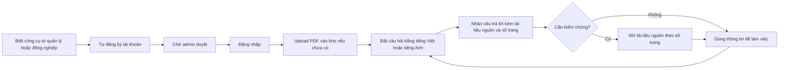

# Product Requirements Document (PRD) — Chat với tài liệu (MVP)

> Chuẩn áp dụng: IEEE 29148-2018. Prompt nguồn: `docs/PRD_Prompt_IEEE_standard.md`.
> Đầu vào: `docs/requirements/BRD.md` v0.7 (BR-001..BR-020, MET-001..003, SRC-001..006). Không có SRS riêng.
> Quy ước: `[Proposed]` = đề xuất của PM, cần xác nhận. `[TBD: OQ-xxx]` = chờ câu hỏi mở. Phiên bản này: 0.2, Draft, 2026-10-20.

---

## 0. Kiểm tra các trụ cột sản phẩm

| Trụ cột (theo prompt) | Giá trị | Trạng thái |
|---|---|---|
| Tên sản phẩm | Chat với tài liệu (MVP) | Có từ BRD |
| Người dùng mục tiêu | Đội phát triển kinh doanh (BD), khoảng 30 người | Có từ BRD (SRC-002) |
| Vấn đề | Tìm một thông tin trong PDF mất 10–15 phút, 5–10 lần mỗi người mỗi ngày (ước lượng, chưa đo) | Có, baseline chưa xác thực (ASM-004) |
| Giải pháp cốt lõi | Web app: upload PDF vào kho chung, hỏi đáp bằng AI, câu trả lời kèm nguồn | Có từ BRD |
| Trụ cột UX | Ít bước, luôn thấy nguồn, nói rõ trạng thái | PM đề xuất, người yêu cầu xác nhận ngày 2026-10-20 |

**Điểm cần lưu ý trước khi dùng PRD:**
1. Hạn rất gấp: pilot bắt đầu 2026-11-03, 20 yêu cầu (RSK-006). PRD đánh dấu P0/P1 để có thể cắt P1 khi cần.
2. Baseline và target do người yêu cầu ước lượng, chưa đo (ASM-004). OKR dùng được cho pilot nhưng cần đo lại baseline trước 2026-11-03.
3. Các câu hỏi chưa trả lời ảnh hưởng thiết kế: câu trả lời dựa trên tài liệu khác ngôn ngữ nhau (OQ-025), lịch sử chat (OQ-013), phạm vi loại trừ (OQ-010), thông báo khi tự động từ chối (OQ-026). PRD đưa ra giả định tạm cho từng câu.

---

## 1. Executive summary và strategy

### 1.1 Product vision

Một nơi duy nhất để đội BD hỏi bất kỳ điều gì về kho tài liệu PDF của mình và nhận câu trả lời có thể kiểm chứng trong vài giây, thay vì mở từng file để tìm. Sau MVP, hướng mở rộng gồm thêm định dạng tài liệu và tích hợp hệ thống khác `[Unverified]`, hiện nằm ngoài phạm vi (BRD mục 5).

### 1.2 Objectives và Key Results

| OKR | Objective | Key result | Baseline | Target | Thời hạn | Truy vết |
|---|---|---|---|---|---|---|
| O1 | Giảm thời gian tìm thông tin | KR1.1: thời gian trung bình để tìm một thông tin (MET-001) | 15 phút (10–15, ước lượng) | 3 phút | Hết pilot, 2027-01-02 | BO-001 |
| O2 | Đội BD dùng công cụ thật | KR2.1: tỷ lệ người dùng dùng hàng tuần trên 30 người được cấp (MET-002) | 0% (công cụ mới) | ≥ 70% (21/30) | Hết pilot, 2027-01-02 | BO-003 |
| O3 | Câu trả lời đáng tin | KR3.1: độ chính xác trên bộ câu hỏi chuẩn (MET-003) | Chưa đo | ≥ 90% | Trước khi bắt đầu pilot (cổng phát hành) và duy trì suốt pilot | BO-002 |
| O3 | Câu trả lời đáng tin | KR3.2: tỷ lệ câu trả lời có nguồn đúng (tên tài liệu và số trang) | Chưa đo | 100% câu trả lời có thông tin trích | Cổng phát hành | BO-002, BR-008 |

> KR1.1 đo bằng nghiên cứu tác vụ mẫu trước và sau, không đo bằng telemetry. Thời điểm đo trước: trước 2026-11-03 (ASM-004).

---

## 2. User personas và user journeys

### 2.1 Personas

| ID | Persona | Mô tả | Mục tiêu | Nỗi đau hiện tại | Nguồn |
|---|---|---|---|---|---|
| PER-01 (chính) | Nhân viên BD | Một trong khoảng 30 người đội BD; tìm thông tin trong PDF 5–10 lần mỗi ngày | Có câu trả lời đúng nhanh để dùng trong công việc | Mở từng file, Ctrl+F, hỏi đồng nghiệp, mất 10–15 phút | SRC-002 |
| PER-02 (phụ) | Admin | Giữ một tài khoản admin có sẵn; duyệt tài khoản mới, xóa tài liệu khi cần | Kiểm soát ai vào kho và nội dung kho | Chưa có công cụ quản lý | SRC-003..005 |
| PER-03 (phụ) | Quản lý / sponsor | Người yêu cầu MVP, ra quyết định tiếp tục hay dừng | Có số liệu sử dụng và chất lượng | Chưa có đo lường | SRC-001 |

> Chưa phỏng vấn người dùng cuối. Persona dựa trên SRC-002. Cần xác nhận ở pilot.

### 2.2 User journey (PER-01)

**Điểm ma sát đã biết:** bước chờ admin duyệt (C) là điểm nghẽn, vì chỉ có một admin cho 30 người. Admin duyệt tối đa 7 ngày; quá hạn tự động từ chối (BR-022). Admin dự phòng: `[TBD: OQ-026]`.

---

## 3. Functional requirements và user stories

Quy ước ưu tiên: **P0** = Must (BRD Must), **P1** = Should, **P2** = Nice-to-have. Mọi story truy vết tới BR trong BRD.

### 3.1 Ma trận epic

| Epic | Tên | Stories | BR truy vết | Persona |
|---|---|---|---|---|
| EP-01 | Tài khoản và truy cập | US-001..US-004, US-016 | BR-012, BR-018, BR-019, BR-020, BR-022 | PER-01, PER-02 |
| EP-02 | Kho tài liệu | US-005..US-009 | BR-001, BR-002, BR-003, BR-004, BR-013, BR-016, BR-017 | PER-01, PER-02 |
| EP-03 | Hỏi đáp | US-010..US-014 | BR-005, BR-006, BR-007, BR-008, BR-011, BR-015, BR-021 | PER-01 |
| EP-04 | Đo lường | US-015 | BR-014 | PER-03 |
| NFR | Phi chức năng | NFR-001, NFR-002 | BR-009, BR-010 | Tất cả |

### 3.2 EP-01 — Tài khoản và truy cập

**US-001 (P0) — Tự đăng ký.** Là nhân viên BD, tôi muốn tự đăng ký tài khoản, để không cần ai tạo hộ. *(BR-018)*
- Given tôi chưa có tài khoản, When tôi gửi form đăng ký hợp lệ, Then hệ thống ghi nhận và hiển thị trạng thái "chờ admin duyệt".
- Given tôi đã đăng ký và chưa được duyệt, When tôi cố đăng nhập, Then tôi bị từ chối và thấy thông báo tài khoản đang chờ duyệt.

**US-002 (P0) — Đăng nhập.** Là người dùng, tôi muốn đăng nhập để truy cập kho tài liệu chung, để tài liệu không bị công khai. *(BR-012)*
- Given tôi chưa đăng nhập, When tôi mở bất kỳ trang kho hoặc trang hỏi đáp, Then tôi được chuyển tới trang đăng nhập và không xem được nội dung.
- Given tôi là người dùng đã được duyệt, When tôi nhập đúng thông tin, Then tôi vào được kho và truy vấn được mọi tài liệu trong kho.

**US-003 (P0) — Admin duyệt tài khoản.** Là admin, tôi muốn xem và duyệt các đăng ký mới, để chỉ người đúng mới vào kho. *(BR-020)*
- Given có tài khoản đang chờ duyệt, When admin duyệt, Then người dùng đó đăng nhập được.
- Given admin từ chối hoặc chưa duyệt, When người đó đăng nhập, Then bị từ chối.

**US-004 (P0) — Tài khoản admin có sẵn.** Là sponsor, tôi muốn có sẵn một tài khoản admin khi vận hành, để có người quản lý từ ngày đầu. *(BR-019)*
- Given hệ thống vừa được triển khai, When tôi đăng nhập bằng tài khoản admin có sẵn, Then tôi duyệt được tài khoản và xóa được tài liệu (US-003, US-009).

**US-016 (P1) — Tự động từ chối đăng ký quá hạn.** Là admin, tôi muốn tài khoản chờ quá 7 ngày tự động bị từ chối, để hàng đợi không tồn đọng. *(BR-022)*
- Given tài khoản chờ duyệt đã quá 7 ngày, When hết hạn, Then trạng thái chuyển thành bị từ chối và người đó không đăng nhập được.
- Given tài khoản được duyệt trong 7 ngày, When hết hạn, Then không bị ảnh hưởng.

### 3.3 EP-02 — Kho tài liệu

**US-005 (P0) — Upload PDF.** Là nhân viên BD, tôi muốn upload PDF vào kho chung, để cả đội hỏi đáp được về nội dung. *(BR-001, BR-002, BR-016)*
- Given tôi đã đăng nhập, When tôi upload một PDF hợp lệ không quá 100 MB, Then tài liệu xuất hiện trong kho và hiển thị trạng thái xử lý, rồi trạng thái sẵn sàng.
- Given tôi đã upload 100 tệp, When tôi upload tệp thứ 101, Then hệ thống từ chối và nêu lý do (đạt giới hạn).
- Given một PDF lớn hơn 100 MB, When tôi upload, Then hệ thống từ chối và nêu lý do (vượt dung lượng).

**US-006 (P1) — Thông báo từ chối rõ ràng.** Là nhân viên BD, tôi muốn biết vì sao tệp bị từ chối, để tự xử lý. *(BR-003)* — Hiểu là mọi lý do từ chối: sai định dạng, tệp hỏng, vượt giới hạn.

**US-007 (P0) — Tài liệu được giữ lại.** Là nhân viên BD, tôi muốn tài liệu đã upload còn đó ở các lần sau, để không phải upload lại. *(BR-004)*
- Given tài liệu đã upload, When tôi đăng xuất rồi đăng nhập lại, Then tài liệu vẫn trong danh sách và truy vấn được cho đến khi bị xóa.

**US-008 (P0) — Xóa tài liệu của mình.** Là người upload, tôi muốn xóa tài liệu của mình, để kiểm soát nội dung đã đưa lên. *(BR-013)*
- Given tôi là người upload, When tôi xác nhận xóa, Then tài liệu biến khỏi danh sách và không còn xuất hiện trong câu trả lời từ truy vấn kế tiếp.
- Given tôi không phải người upload và không phải admin, When tôi mở tài liệu đó, Then không có hành động xóa.

**US-009 (P0) — Admin xóa mọi tài liệu.** Là admin, tôi muốn xóa bất kỳ tài liệu nào, để quản lý nội dung kho. *(BR-017)*
- Given tài liệu do người khác upload, When admin xác nhận xóa, Then tài liệu biến khỏi danh sách và không còn xuất hiện trong câu trả lời từ truy vấn kế tiếp.

### 3.4 EP-03 — Hỏi đáp

**US-010 (P0) — Hỏi xuyên mọi tài liệu.** Là nhân viên BD, tôi muốn hỏi bằng ngôn ngữ tự nhiên về toàn bộ kho, để không phải chọn từng file. *(BR-005, BR-006)*
- Given kho có tài liệu sẵn sàng, When tôi gửi câu hỏi, Then tôi nhận câu trả lời dựa trên nội dung các tài liệu trong kho.
- Given thông tin nằm ở hai tài liệu khác nhau, When tôi hỏi, Then câu trả lời phản ánh cả hai.

**US-011 (P0) — Câu trả lời có nguồn.** Là nhân viên BD, tôi muốn thấy tài liệu và số trang cho mỗi thông tin, để kiểm chứng. *(BR-008)*
- Given câu trả lời có thông tin trích từ tài liệu, When hiển thị, Then mỗi thông tin kèm tên tài liệu và số trang; mở trang đó thấy nội dung tương ứng.

**US-012 (P0) — Không bịa khi không có thông tin.** Là nhân viên BD, tôi muốn được báo rõ khi tài liệu không có đáp án, để không dùng thông tin sai. *(BR-007)*
- Given đáp án không có trong kho, When tôi hỏi, Then hệ thống trả lời rõ "không tìm thấy trong tài liệu" và không đưa ra nội dung không có căn cứ.

**US-013 (P0) — Hai ngôn ngữ.** Là nhân viên BD, tôi muốn hỏi bằng tiếng Việt hoặc tiếng Anh về tài liệu viết bằng một trong hai, để không bị giới hạn ngôn ngữ. *(BR-011, BR-015, BR-021)*
- Given tài liệu tiếng Việt hoặc tiếng Anh, When tôi hỏi bằng tiếng Việt, Then nhận câu trả lời đúng; When tôi hỏi bằng tiếng Anh, Then nhận câu trả lời đúng.
- Given câu trả lời dựa trên tài liệu tiếng Việt, When tôi hỏi bằng tiếng Anh, Then câu trả lời bằng tiếng Việt; và ngược lại. Ngôn ngữ câu trả lời theo ngôn ngữ của tài liệu (quyết định 2026-10-20, BR-021).
- Khi câu trả lời dựa trên nhiều tài liệu khác ngôn ngữ nhau: `[TBD: OQ-025]`.

**US-014 (P2) — Lịch sử hội thoại.** Là nhân viên BD, tôi muốn xem lại các câu hỏi trước, để không hỏi lại. Chưa có BR; chờ OQ-013. Không làm trong MVP nếu hết thời gian.

### 3.5 EP-04 — Đo lường

**US-015 (P0) — Báo cáo pilot.** Là sponsor, tôi muốn có số liệu sử dụng và chất lượng, để quyết định tiếp tục hay dừng. *(BR-014)*
- Given pilot đang chạy, When tôi xem báo cáo, Then tôi thấy MET-002 theo tuần và số liệu hỗ trợ tính MET-001, MET-003 theo mục 5.2.

### 3.6 Yêu cầu phi chức năng

| ID | Yêu cầu | Ngưỡng | BR | Cách xác minh |
|---|---|---|---|---|
| NFR-001 (P1) | Thời gian trả lời | ≤ 30 giây cho 90% câu hỏi | BR-009 | Test trên bộ câu hỏi chuẩn. "10–30 giây" hiểu là ngưỡng tối đa 30 giây (OQ-006) |
| NFR-002 (P0) | Độ chính xác | ≥ 90% trên bộ câu hỏi chuẩn; bộ câu hỏi có cả tiếng Việt và tiếng Anh | BR-010 | business owner chấm |
| NFR-003 (P0) | Giới hạn dữ liệu | 100 MB mỗi tệp; 100 tệp mỗi người | BR-002, BR-016 | Test biên |
| NFR-004 (P0) | Truy cập | Không truy cập kho khi chưa đăng nhập và được duyệt | BR-012, BR-020 | Test phân quyền |

---

## 4. UX và UI requirements

> Trụ cột UX do PM đề xuất và người yêu cầu xác nhận ngày 2026-10-20: **(1) ít bước, (2) luôn thấy nguồn, (3) nói rõ trạng thái**.

### 4.1 Layout và luồng chính

| Màn hình | Bố cục kỳ vọng | Tương tác then chốt |
|---|---|---|
| Đăng ký / Đăng nhập | Một form; sau đăng ký hiện trạng thái chờ duyệt | Phân biệt rõ "sai thông tin", "chờ duyệt" và "bị từ chối do quá 7 ngày" |
| Trang chính | Hai khung: trái là kho tài liệu (danh sách, upload, xóa), phải là khung chat | Upload và hỏi đáp không rời trang |
| Câu trả lời | Khối trả lời ở trên, danh sách nguồn (tên tài liệu, số trang) ở dưới, mỗi nguồn bấm mở được | Mở nguồn đưa đúng trang |
| Quản trị (admin) | Danh sách tài khoản chờ duyệt; danh sách mọi tài liệu có nút xóa | Duyệt và xóa cần xác nhận |

Chi tiết điều hướng:
- Chưa đăng nhập thì mọi đường dẫn chuyển tới đăng nhập (US-002).
- Admin thấy thêm mục quản trị; người dùng thường không thấy.
- Xóa luôn hỏi xác nhận vì xóa là vĩnh viễn (BRU-003).

### 4.2 Edge cases và trạng thái lỗi

| Tình huống | Hành vi mong đợi |
|---|---|
| Mất mạng khi upload | Báo upload lỗi, giữ tệp trong form để thử lại; không tạo tài liệu hỏng trong kho |
| Mất mạng khi hỏi | Báo không gửi được, giữ nguyên câu hỏi trong ô nhập để gửi lại |
| Kho trống | Hiện hướng dẫn "Upload PDF để bắt đầu" và vô hiệu hóa ô hỏi |
| Tài liệu đang xử lý | Hiện trạng thái đang xử lý; câu hỏi chỉ dựa trên tài liệu đã sẵn sàng và nói rõ nếu còn tài liệu chưa sẵn sàng `[Proposed]` |
| PDF không có văn bản đọc được (bản scan) | Báo tài liệu không đọc được nội dung, không đưa vào kết quả (ASM-001) |
| Tệp sai định dạng, hỏng, quá lớn, quá số lượng | Từ chối kèm lý do cụ thể (US-006) |
| Câu hỏi rỗng hoặc quá dài | Không gửi; nêu giới hạn `[TBD: OQ-023]` |
| Không có đáp án trong tài liệu | Trả lời "không tìm thấy" (US-012) |
| Quá thời gian trả lời | Hiện thông báo đang xử lý lâu và cho phép hủy hoặc thử lại `[Proposed]` |
| Tài liệu nguồn đã bị xóa khi người dùng đang xem câu trả lời cũ | Báo tài liệu không còn tồn tại khi mở nguồn |
| Phiên đăng nhập hết hạn | Chuyển về đăng nhập, giữ câu hỏi chưa gửi nếu có thể |
| Hai người cùng upload một tệp trùng | Cho phép, hai bản riêng `[Proposed, chờ xác nhận]` |
| Đăng ký bị tự động từ chối sau 7 ngày | Đăng nhập báo rõ lý do; cho phép đăng ký lại `[Proposed, chờ OQ-026]` |
| Câu trả lời dựa trên tài liệu khác ngôn ngữ nhau | Chưa quyết định `[TBD: OQ-025]` |

---

## 5. Release criteria và post-launch metrics

### 5.1 Launch gate (trước 2026-11-03)

| Gate | Tiêu chí | Truy vết |
|---|---|---|
| G1 Chức năng | 100% story P0 đạt toàn bộ Given-When-Then; không còn lỗi Sev1/Sev2 `[Proposed]` | US-001..US-013, US-015 |
| G2 Chất lượng trả lời | Độ chính xác ≥ 90% trên bộ câu hỏi chuẩn, đủ cả tiếng Việt và tiếng Anh | BR-010, NFR-002 |
| G3 Tin cậy | 100% câu trả lời có thông tin trích đều có nguồn đúng; 100% câu hỏi không có đáp án nhận "không tìm thấy" | BR-007, BR-008 |
| G4 Hiệu năng | ≥ 90% câu hỏi trả lời trong 30 giây (P1; nếu chưa đạt, ghi nhận và quyết định có phát hành không) | BR-009 |
| G5 Giới hạn | Test biên 100 MB và 100 tệp đạt | NFR-003 |
| G6 Bảo mật | Không truy cập được khi chưa đăng nhập hoặc chưa được duyệt; người không phải chủ và không phải admin không xóa được tài liệu | NFR-004, BR-013, BR-017 |
| G7 Đo lường | Có sẵn sự kiện ở mục 5.2 và báo cáo pilot | BR-014 |
| G8 Dữ liệu nghiệm thu | Có bộ PDF mẫu và bộ câu hỏi chuẩn từ đội BD, đo baseline MET-001 xong | DEP-002, ASM-004 |
| G9 Rà soát | PDF mẫu không có thông tin mật; admin có danh sách đội BD để đối chiếu | ASM-003, ASM-005 |
| G10 Xác nhận độc lập | Có người review độc lập BRD và PRD | OQ-015 |

> Ngưỡng độ phủ test và Sev1/Sev2 là đề xuất `[Proposed]`; BRD không quy định.

### 5.2 Analytics và tracking

Mọi sự kiện ghi kèm `user_id`, `timestamp`. Không ghi nội dung câu hỏi hoặc câu trả lời trong sự kiện nếu chưa có quyết định về quyền riêng tư `[TBD: OQ-024]`.

| ID | Sự kiện | Thuộc tính | Mục đích |
|---|---|---|---|
| EVT-001 | `register_submitted` | — | Phễu đăng ký |
| EVT-002 | `account_approved`, `account_auto_rejected` | `wait_time` | Thời gian chờ duyệt, điểm nghẽn admin, số đăng ký quá hạn 7 ngày |
| EVT-003 | `login_success`, `login_failed` | `reason` | Truy cập; MET-002 |
| EVT-004 | `document_upload_started`, `document_ready`, `document_rejected` | `size_mb`, `reject_reason` | Phễu upload; BR-003 |
| EVT-005 | `document_deleted` | `deleted_by` (owner/admin) | BR-013, BR-017 |
| EVT-006 | `question_submitted` | `language` | Mức dùng; MET-002; BR-015 |
| EVT-007 | `answer_returned` | `latency_ms`, `has_citation`, `not_found` | NFR-001; BR-007, BR-008 |
| EVT-008 | `citation_opened` | — | Mức kiểm chứng nguồn |
| EVT-009 | `answer_feedback` (đúng/sai) | `answer_id` | Thu thập chất lượng thực tế, bổ trợ MET-003 `[Proposed, cần thêm story]` |

**Cách tính metric:**
- **MET-002** = số người có ít nhất một `question_submitted` trong tuần / 30, tính theo tuần suốt pilot. Dùng hàng tuần được hiểu là có ít nhất một câu hỏi trong tuần `[Unverified]`.
- **MET-003** = đo trước phát hành và định kỳ trên bộ câu hỏi chuẩn; EVT-009 chỉ là tín hiệu bổ sung.
- **MET-001** = nghiên cứu tác vụ mẫu trước và sau, không từ telemetry.

**Phễu theo dõi:** đăng ký (EVT-001) → được duyệt (EVT-002) → đăng nhập lần đầu (EVT-003) → upload tài liệu đầu tiên (EVT-004) → câu hỏi đầu tiên (EVT-006) → câu hỏi lần hai trong cùng tuần.

---

## 6. Truy vết, giả định và câu hỏi mở

### 6.1 Truy vết BR → story

| BR | Story / NFR | BR | Story / NFR |
|---|---|---|---|
| BR-001 | US-005 | BR-011 | US-013 |
| BR-002 | US-005, NFR-003 | BR-012 | US-002, NFR-004 |
| BR-003 | US-006 | BR-013 | US-008 |
| BR-004 | US-007 | BR-014 | US-015 |
| BR-005 | US-010 | BR-015 | US-013 |
| BR-006 | US-010 | BR-016 | US-005, NFR-003 |
| BR-007 | US-012 | BR-017 | US-009 |
| BR-008 | US-011 | BR-018 | US-001 |
| BR-009 | NFR-001 | BR-019 | US-004 |
| BR-010 | NFR-002 | BR-020 | US-003 |
| BR-021 | US-013 | BR-022 | US-016 |

Coverage: 22/22 BR có story hoặc NFR. US-014 (P2) chưa có BR, chờ OQ-013.

### 6.2 Câu hỏi mở của PRD

| ID | Câu hỏi | Ảnh hưởng | Kế thừa |
|---|---|---|---|
| OQ-013 | Có lưu lịch sử chat không? | US-014 | BRD |
| OQ-014 | Ngôn ngữ câu trả lời: theo câu hỏi hay theo tài liệu? | US-013 | BRD. **Đã đóng 2026-10-20**: theo ngôn ngữ tài liệu (BR-021) |
| OQ-010 | Xác nhận phạm vi loại trừ | Toàn PRD | BRD |
| OQ-015 | Ai review độc lập? | G10 | BRD |
| OQ-022 | Admin duyệt đăng ký trong bao lâu (SLA)? Cần thêm admin dự phòng không? | Journey bước C, EVT-002 | Mới. **Đóng một phần 2026-10-20**: tối đa 7 ngày, quá hạn tự động từ chối (BR-022). Admin dự phòng: OQ-026 |
| OQ-023 | Giới hạn độ dài câu hỏi? | Mục 4.2 | Mới |
| OQ-024 | Có được ghi nội dung câu hỏi và câu trả lời để đánh giá chất lượng không? | Mục 5.2, EVT-009 | Mới |
| OQ-025 | Khi câu trả lời dựa trên nhiều tài liệu khác ngôn ngữ nhau (Việt và Anh), trả lời bằng ngôn ngữ nào? | US-013, BR-021 | Mới |
| OQ-026 | Người bị tự động từ chối có được thông báo và đăng ký lại không? Có admin dự phòng không? | US-016, journey bước C | Mới |

### 6.3 Giả định của PM

- Hai người có thể upload tệp trùng, mỗi tệp là một bản riêng.
- Tài liệu chỉ được truy vấn sau khi ở trạng thái sẵn sàng.

---

## 7. Readiness statement

**Ready for review.**

Đã đóng ngày 2026-10-20: trụ cột UX, ngôn ngữ câu trả lời (OQ-014), SLA duyệt tài khoản (OQ-022).

Không chặn review nhưng cần đóng trước phát hành:
- **OQ-025** — câu trả lời dựa trên tài liệu khác ngôn ngữ nhau (ảnh hưởng US-013, P0).
- **OQ-026** — thông báo khi tự động từ chối, đăng ký lại, admin dự phòng.
- **OQ-010, OQ-013, OQ-015, OQ-023, OQ-024**.
- Cổng G8 và G9: đo baseline MET-001 (ASM-004), rà soát PDF mẫu (ASM-003, ASM-005).
